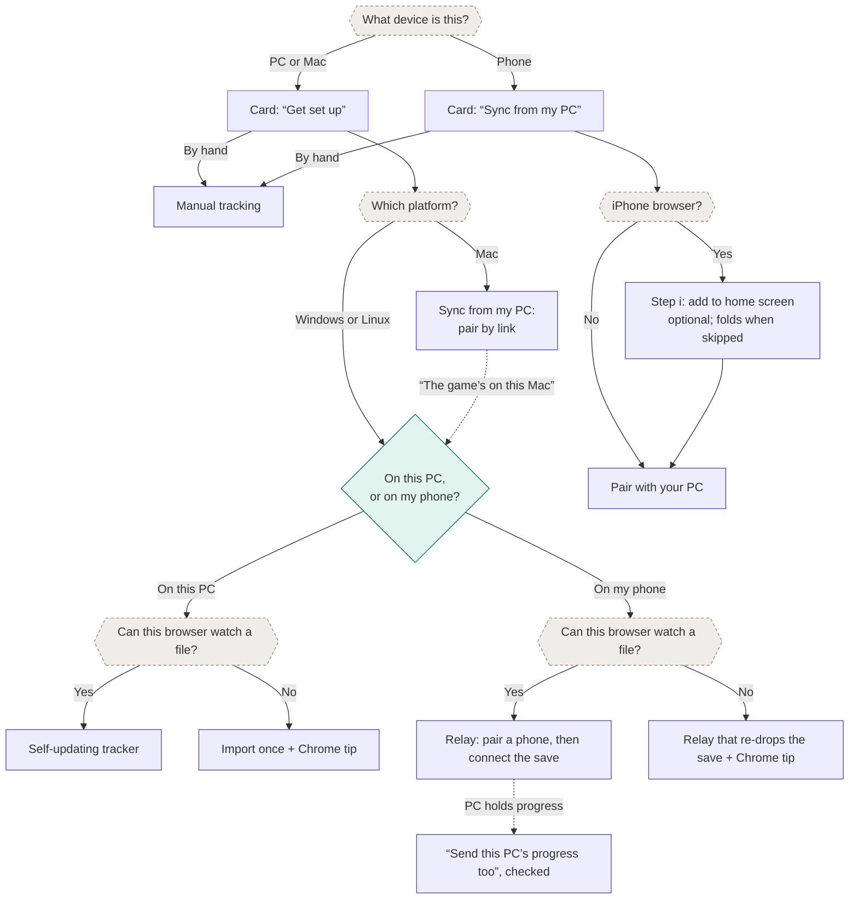

# Sync setup & pairing

tl;dr: The app detects what it can (device, platform, iPhone browser vs. installed app, whether the
browser can watch a file) and asks only what it can’t. Home invites with one card; all setup happens
on one page, `mistria.fyi/sync`, which Data also links to. On a PC that page asks one question: will
you check things off on this PC or on your phone? Each browser ends up in one role: a **tracker**, a
**self-updating tracker**, or a **relay**. This document is the journey, the screens, & the copy for
#131; the protocol is in [sync.md](sync.md).

Status: screens & copy in review on #131. Every state has a mockup on the
[design canvas](https://claude.ai/artifact/UhDfkQVf4Csu7eN9RcBStx) (version 45); [Screens](#screens)
embeds a sheet per section. The happy path is approved; error & notice screens are first drafts.

## Mental model

Three parts, named the same way everywhere:

1. **The game** writes a save file on the PC each time you sleep (and when you load in).
2. **The relay**, a browser tab on that PC, watches the file & sends each new save onward.
3. **The tracker**, on your phone, receives it & updates your progress.

Sync moves the game’s save in one direction. Things checked off by hand stay on the device where
they were checked off, except once: when a PC that already holds progress pairs, it can send that
progress along (see [Carrying the PC’s progress](#carrying-the-pcs-progress)).

Player-facing names: “the game”, “your PC”, “your phone”, & “the tracker”. The PC tab calls itself
“the relay” only where its role matters (“This PC is the relay”).

## Roles

| Role                  | Where                   | Checks things off          | Gets progress from                           |
| --------------------- | ----------------------- | -------------------------- | -------------------------------------------- |
| Tracker (default)     | Any device              | Yes                        | Sync, a one-time import, or by hand          |
| Self-updating tracker | The PC running the game | Yes                        | Its own watched save                         |
| Relay                 | The PC running the game | No; the guide is read-only | Its own watched save, mirrored for reference |

- A browser is a tracker until setup makes it something else.
- **A relay never touches stored progress.** Whatever the browser had tracked stays in storage,
  untouched & hidden, while it relays. The read-only mirror lives in its own storage, outside stored
  progress & backups, and is discarded when the relay is turned off. Turning it off shows the stored
  progress again exactly as it was left.
- **A self-updating tracker** watches the save the same way a relay does but applies it locally,
  with no phone & no network. Check-offs are safe there, because nothing leaves the browser.
- **Why a relay doesn’t track.** If the PC tab took check-offs while relaying, they’d silently fail
  to reach the phone, which contradicts the mental model. A read-only mirror of the latest save
  keeps the guide useful on the PC without that trap. The relay already parses each save, so the
  mirror costs little.
- **The relay is a dashboard first.** In relay mode the app opens on a status dashboard: which
  phone, which save, when it last sent. Browsing the guide is a side trip from there. Trouble takes
  over that view and stays until dismissed, so a broken relay is hard to miss.

## First look

New players see the Home welcome card, which only invites; they can poke around first. The card’s
setup action opens `mistria.fyi/sync`, which does the work. “I’ll check things off by hand”
dismisses the card, as today.

- **On a PC,** the card lists what setup gets you (import your progress, keep it up to date, sync it
  to your phone) under one “Get set up” button, “About two minutes”. The card reads the same on
  Windows, Mac, & Linux.
- **On a phone,** the card’s button is “Sync from my PC”, with the step count on it (“2 steps, about
  two minutes”, or “3 quick steps” in an iPhone browser), and “How it works” beside it.
- **The setup page asks one question on a PC:** “On this PC” (1 step) or “On my phone” (2 steps).
  The two paths are whole-card buttons with an “or” between them, so they read as exclusive. “How it
  works” sits with the phone path, the only one it explains, and opens a tag dialog.
- **The redesign drops WelcomeCard’s corner ring & accent wash.** The ring waits on #10’s marginalia
  decision; the Field Guide doesn’t otherwise use gradients.

### The decision tree

Diamonds are questions the player answers; hexagons are checks the app makes itself and never asks.

- **Import defaults to self-updating.** “On this PC” in a browser that can watch files gets the
  self-updating tracker without being asked; elsewhere it imports once, with the Chrome tip.
- **The choice is remembered,** and Data links back to the setup page. Every path stays reachable.
- **A Mac pairs like a phone.** Fields of Mistria has no Mac build, so a Mac is almost always where
  the player checks things off. A link covers CrossOver & Whisky players. A Linux PC or Steam Deck
  usually runs the game through Proton, so it gets the PC question.

### What the app can detect

| Check                     | How                                                                                                                                                 | Confidence                                |
| ------------------------- | --------------------------------------------------------------------------------------------------------------------------------------------------- | ----------------------------------------- |
| PC or phone               | User-Agent Client Hints `mobile` (Chrome & Edge only), plus a coarse pointer & screen size everywhere; “I’m on a computer” & “I’m on a phone” links | Heuristic; keep the overrides             |
| Platform                  | User-Agent Client Hints `platform`, else the user agent (`Windows`, `Macintosh` without touch, `Linux` or `X11` without `Android`)                  | Reliable; only picks defaults             |
| Installed or in a browser | `matchMedia("(display-mode: standalone)")`; `navigator.standalone` on iOS                                                                           | Reliable on iOS & Android                 |
| iPhone or iPad browser    | iOS user agent, or `Macintosh` with `navigator.maxTouchPoints > 1` (iPad Safari reports a Mac), & not standalone                                    | Reliable for iPhone; heuristic for iPad   |
| Can watch a file          | Feature checks for `FileSystemObserver` & drag-and-drop file handles                                                                                | Shows support only; behavior pending #130 |

- **Every iOS & iPadOS browser behaves like Safari here.** All of them, Firefox included, run on
  WebKit, and a home screen web app keeps its own storage apart from the browser that added it.
  Confirm on Firefox for iPhone during #130.
- **File watching is a capability check, not a promise.** A browser can have `FileSystemObserver`
  and still lose the file when the game replaces it instead of rewriting it; #130 checks that.
- **Android needs no install step.** An app installed from Chrome shares its storage with Chrome, so
  the data is already there.

### Why install on iPhone

A page can’t install itself on iOS, & `navigator.share` opens a share sheet without “Add to Home
Screen”, so the step gives instructions. Links, including Camera scans, always open in Safari, never
in the home screen app. The step still earns its place: Safari deletes a site’s script-written
storage after seven days of Safari use without visiting it, which would take progress & pairing keys
with it, while a home screen app keeps its own clock that only its own use resets. It also opens
full screen with its own icon. The step stays optional but recommended; #130 confirms the storage
behavior on current iOS.

## Save folders

| Platform                   | Folder                                                                                                              | How the step opens it                                 |
| -------------------------- | ------------------------------------------------------------------------------------------------------------------- | ----------------------------------------------------- |
| Windows                    | `%LOCALAPPDATA%\FieldsOfMistria\saves`                                                                              | Paste into File Explorer’s address bar, press Enter   |
| Linux & Steam Deck, Proton | `~/.local/share/Steam/steamapps/compatdata/2142790/pfx/drive_c/users/steamuser/AppData/Local/FieldsOfMistria/saves` | In the file manager, press Ctrl+L, paste, press Enter |
| Mac, CrossOver             | `~/Library/Application Support/CrossOver/Bottles/Steam/drive_c/users/crossover/AppData/Local/FieldsOfMistria/saves` | In Finder, press Shift-Command-G, paste, press Return |

Fields of Mistria’s Steam app ID is 2142790 ([SteamDB](https://steamdb.info/app/2142790/)). The
Proton & CrossOver paths, & Steam Deck’s browser, are unverified; #130 checks them. Other Wine
setups get “Look in its drive_c folder”.

## Setup journey

Setup starts on whichever device the player is holding. Starting on the phone, it says to open
`mistria.fyi/sync` on the PC in Chrome or Edge; arriving there from a phone’s instructions, the PC
still asks its one question. Either way, pairing comes first, then the save. The phone scans with
the tracker’s own scanner, so the pairing lands in whichever copy the player is using.

| Step | On the PC                                                                                                       | On the phone                                                        |
| ---- | --------------------------------------------------------------------------------------------------------------- | ------------------------------------------------------------------- |
| 1    | Picks “On my phone” on `mistria.fyi/sync`                                                                       | iPhone browser only: add to home screen, or skip                    |
| 2    | Shows a covered code; “Show code” reveals it & “Copy link”                                                      | With progress, asks “Keep what I have” or “Start fresh” (confirmed) |
| 3    |                                                                                                                 | Taps “Scan the code” & scans, or “Or paste a link”                  |
| 4    | Shows a six-digit code; the player confirms it matches (equal-weight buttons, “Haven’t scanned yet? Choose No”) | Shows the same code, then “You’re paired!”                          |
| 5    | Sends this PC’s progress, if checked                                                                            | “Your PC’s progress is here too”                                    |
| 6    | Connect the save: copy the folder path, drag the newest file in                                                 | Waits for the first save                                            |
| 7    | Sends the save                                                                                                  | “It worked!”: progress appears                                      |
| 8    | Opens on the relay dashboard while the player plays                                                             | Updates each time the player sleeps in the game                     |

Why pair first: the player sees success on the phone right away, and finishing the save step makes
progress appear on the phone moments later, which demonstrates the whole system once.

- **Steps are cards.** The current step is open with an accent rule; done steps fold to one line
  with a green rule & check; later steps fold & fade. A skipped step folds to “Skipped. Add it any
  time.” with “Show me”, so it never vanishes. Steps that don’t apply (installing, off iPhone) are
  absent.
- **The Chrome tip.** In a browser that can’t watch a file & isn’t Chrome or Edge, a “Field tip”
  shipping tag sits above the steps: “Let Chrome do this for you”, with “Copy this page’s link”.
  Headlines say Chrome; body text says “Chrome or Edge”. It can’t be dismissed. A Chrome or Edge
  that fails the check gets no tip, only the import-once copy.
- **Copy follows the mode.** Promises of updates “every time you sleep” appear only where the save
  is watched; the import-once & re-drop paths say “whenever you drop it in” instead, on the PC & in
  the phone’s success note.
- **Drag only, where the save is watched.** Windows refuses the file picker under `%LOCALAPPDATA%`,
  & a picked file gives no handle to watch, so the watched drop box has no “browse files”.
  Import-once & re-drop keep it. A keyboard path to a watched handle is a #130 check.
- **Every receiver can scan or paste.** “Scan the code” has “Or paste a link” under it, & a phone
  that can’t use its camera says so & shows the paste field.
- **Instructions name the PC’s question:** “open mistria.fyi/sync, pick “On my phone”, & click “Show
  code””.
- **The match step resists a reflex “Yes”.** Both buttons have equal weight, with “Haven’t scanned
  yet? Choose “No”.” under them; once the other device answers, the PC’s copy names it (“Does your
  Mac show this code?”).
- **The Camera path on iPhone.** The Camera opens codes in the default browser, so a code that
  arrives that way asks “Pair this browser, or the app?” as a tag dialog, naming the browser it
  detects. “Pair Safari” is primary, since most players have no app yet; “I’ll use the app” closes
  the dialog, which says to open the app & tap “Scan the code”, since a page can’t open it.
- **The install step names no browser.** “Tap Share. In Safari, it may be under •••.” covers
  Safari’s compact layout (iOS 26) & the other iOS browsers’ own Share menus.

### Pairing a computer

A Mac or a second PC has no camera aimed at the screen. With the code showing, the PC also offers
“Copy link”: the same offer URL the QR holds. The player sends it to the other computer however’s
easiest (“like a message to yourself”) & opens it there, or pastes it into the setup page. It
arrives like a Camera-opened code, & the match code guards it the same way. “Scan with this
computer’s camera instead” stays as a fallback. The offer still expires after a couple of minutes;
the PC shows the time left beside “Copy link”, & whether copying should restart the window is a
protocol question for `sync.md`. The PC’s choice reads “On my phone” with “Or another computer, like
a Mac.” under it, and its copy names the device once one answers.

### Carrying the PC’s progress

When the PC holds progress, pairing shows “Send this PC’s progress too”, checked, under the code:
“It adds to what’s on your phone, including things you checked off by hand.” After the phone
confirms the pairing, the PC sends that progress once through the sync channel, & the phone merges
it in before the first save. This replaces exporting a backup on the PC & restoring it on the phone.
See [sync.md](sync.md#carrying-the-pcs-progress) &
[the decision record](decisions/2026-10-28-sync-carry-pc-progress.md).

- **The phone decides about its own progress.** The PC can’t see the phone’s data before pairing, so
  a phone with progress asks: “Keep what I have” (the PC’s progress adds on top) or “Start fresh”. A
  code that arrives by Camera or link asks right after answering, which holds the offer open.
- **“Start fresh” changes nothing yet.** It asks first (“Start fresh on this phone?”), & the phone
  replaces its progress only when the first incoming bundle arrives, keeping a backup of what was
  there, like a farm switch. Abandoning setup leaves the phone as it was.
- **Re-pairing shows it unchecked.** A relay’s stored progress is stale; a new phone gets its
  progress from the old phone instead (see [A new phone](#a-new-phone)).
- **Both devices show the wait.** The PC’s step reads “Sending your progress”, then “Waiting on your
  {device}…”, with “Skip it”, which drops the progress & lets saves through. The phone shows “Your
  PC’s progress is on its way” instead of waiting on a save.
- **A different farm is a farm switch.** The phone keeps a backup of its own farm & says “We saved a
  backup of {farm}”, with the backup in Data.
- **The PC’s stored progress stays where it is,** untouched, while it relays.

### When pairing can’t start

- **The robot check.** Turnstile runs when the player reveals the code. If it fails, the step shows
  “We couldn’t check you’re not a robot” with “Try again”, & no code.
- **Pairing is full today.** New pairings have a daily cap to keep sync free; the step says so,
  without a code, & that nothing’s lost.
- **A phone that can’t pair yet.** A phone whose stored progress is quarantined or from a newer
  build refuses to pair & sends the player to Data to sort it out first.

## Any time, not just first run

Every path stays reachable from Data, which links to the same setup page. Changing roles later:

- **Tracker or self-updating tracker → relay.** Setup offers to carry the PC’s progress, as above.
- **Tracker → self-updating tracker.** The first watched save applies through the apply rules
  (#129), like any sync, so earlier check-offs aren’t overwritten blindly.
- **Phone with progress → paired.** The first save asks “Is this the farm you’ve been tracking?” and
  merges through the apply rules (#135).
- **Relay → tracker.** Unpairing discards the mirror and shows the stored progress exactly as it was
  left.
- **Paired phone → unpaired.** Unpairing keeps everything already on the phone, which says “Your PC
  unpaired this phone”; a PC whose phone unpaired says “Your {device} unpaired” & offers “Fill in
  from your latest save”.
- **Paired, but no save yet.** A relay abandoned after pairing shows “Almost there: connect your
  save”; the phone’s sync button shows a hairline slip, “Waiting for your first save”.

## A new phone

Manual check-offs live on the phone, not on the relay, so pairing a new phone from the PC alone
would leave them behind. “Pair a different phone” therefore opens a tag dialog first: “New phone?
Bring your progress first. Things you checked off by hand live on your {device}, not on this PC.”
with “Let’s do it” & a quieter “Skip, start the new phone fresh”.

1. **Move your progress from the old phone.** On the old phone, Data › “Move to Another Device”
   shows a one-time handoff code (with “Copy link”); the new phone scans it from `mistria.fyi/sync`,
   & both show a match code, confirmed on the old phone. The old phone sends its progress once &
   keeps it too. The new phone says “Your progress is here” & continues to pairing.
2. **Pair the new phone** with the PC, as usual. The old phone keeps its progress & stops getting
   saves.

The handoff reuses pairing’s offer, handshake, & match code, & sends one progress bundle, the same
payload as [Carrying the PC’s progress](#carrying-the-pcs-progress); see
[sync.md](sync.md#carrying-the-pcs-progress). An empty receiver takes it whole, so this path needs
no merge. The same handoff moves Safari’s progress into the iPhone app, by link.

## Data management

The page keeps its name: pairing moves data too, and “Settings” already names the toolbar gear’s
panel. Its intro becomes “Pair your devices, or import, back up, or reset your Field Guide
progress.” It regroups into two sections:

- **Pairing:** “Pair with Your Phone” on a PC (“Keep your phone up to date every time you play.”) or
  “Pair with Your PC” on a phone (“Get each new save from your PC as you play.”). Open, it shows the
  device & last send, “Pair a different phone”, & “Unpair”. Its setup button opens the setup page.
- **Data:** “Import from Save File” (which also hosts the self-updating state & the relay’s save,
  with “Use a different save”), “Move to Another Device” (“Send your progress to a new phone or the
  app, once.”), “Backup & Restore” (“Keep a copy of your progress, or restore one.”), & “Danger
  Zone”.
- **On a relay,** Data keeps only Pairing, Import (the relay’s save), & “Export backup”, which notes
  it’s this PC’s progress from before it started relaying. Restore, move, & reset come back after
  unpairing, & a note says so.

“Move to Another Device” replaces “Transfer to Another Device”, which leaves with #138: the same
place & job, on the handoff code instead of the build-bound transfer codec. Each card says why you’d
pick it: pairing keeps a phone up to date, moving sends progress once, & a backup keeps a copy. Card
titles stay in title case to match their siblings. Confirmations (“Pair a different phone?”, “Unpair
your {device}?”) use the tag dialog.

## The relay dashboard

- The relay opens on its dashboard: one card, near the vertical middle of the page, so it reads as
  “this is all there is, & it’s working”. It names the phone, the last save, & where that save is:
  uploaded (“Your {device} hasn’t picked it up yet”), received (“On your {device}, waiting on a
  question there”), or applied (“Applied on your {device}”), with “Pairing settings”. “Up to date”
  names the last applied in-game date, never the last upload.
- “Browse the guide” opens the full guide, read-only, mirroring the latest save, under the note
  “Read-only on the relay. From your {device}’s save at {time}.”
- Trying to check something off there shows a toast: “This PC is the relay. Check things off on your
  {device}.”
- Trouble takes over the card in amber, or red for errors (an unreadable save), until dismissed; a
  pause on our side is hairline, since there’s nothing to do. Red is the `--destructive` tone
  StatusNote already uses for errors.
- Start here and watch real use. If the read-only guide goes unused or only confuses, remove it and
  keep the dashboard alone.

## Status on the phone

Sync status lives in a quiet toolbar button beside settings & feedback. It speaks up only when
something is late or wrong: a colored dot, plus a short slip above it (“No saves in 5 days”, “Sync’s
taking a break”). Tapping it opens a compact panel in the toolbar-panel style: where progress comes
from, when, the last save’s date, & “Pairing & data settings”. The self-updating PC uses the same
button. Notices that need more than a slip are field notes on Home (below).

### Tone & notices

- **Amber** needs you, **red** is an error, **green** is good news, & **hairline** is just so you
  know.
- Notices are field notes: a taped-in slip with a tilted icon marker & the app’s highlighter band
  under the title. Questions & confirmations use the tag dialog.
- The relay’s own notices (“Your save file moved”, “Another tab’s already the relay”, “Waiting for
  the internet”, the daily cap, & “needs a tracker update”) stack as field notes under its card.

## Moving to the installed app on iPhone

iOS keeps a browser’s data apart from the home screen app, so the app can’t move it.

- **First launch of the installed app leads with sync.** It opens on the phone welcome card (“Sync
  from my PC”), since most players install mid-setup & have nothing in Safari. “Used the tracker in
  Safari? Bring it over” is a secondary link.
- **Bringing it over uses the handoff, by link.** In Safari, Data › “Move to Another Device” › “Copy
  link”; back in the app, paste it & check the codes match. The app is empty, so it takes the
  progress whole, provenance included.
- **Then pair again from the app.** Pairing keys stay with each copy, so the app pairs fresh. With
  one phone per PC, the PC’s match step notes “This replaces Safari on your iPhone”, & Safari shows
  the ordinary “Your PC paired with another device” note & keeps what it has.

## Living with it

| Stage           | Relay (PC)                                                              | Tracker (phone)                                                                             |
| --------------- | ----------------------------------------------------------------------- | ------------------------------------------------------------------------------------------- |
| Playing         | Dashboard open; nothing to do                                           | Quiet sync button; its panel says when the last save came                                   |
| Away for days   | Pairing lapses after 90 days unseen; dashboard says to re-pair          | Slip after an unusually long gap; after the lapse, a field note to re-pair                  |
| Browser restart | Asks to re-allow reading the save (one click; “every visit” sticks)     | Nothing                                                                                     |
| Game update     | Can’t read the save: takes over the dashboard                           | Keeps its last good progress; the panel’s date ages                                         |
| App update      | Reloads itself at a safe moment; “Your {device} needs a tracker update” | Same; “Update the tracker on your PC” or “Update this phone”, naming the side that’s behind |
| New phone       | Starts by moving progress from the old phone, then pairs the new one    | Old phone hands off its progress, keeps it, & stops getting saves                           |
| New farm        | Drop the new save                                                       | Asks “Is this the farm you’ve been tracking?”; backs up the old one (#135)                  |
| Kill switch     | “Sync is taking a break”, hairline                                      | Hairline dot & slip; tracking by hand still works                                           |
| Stop syncing    | “Unpair”: back to a tracker                                             | Unpaired; keeps everything                                                                  |
| Non-Chrome PC   | Re-drop the save after each session to send it                          | Updates whenever a save is re-dropped                                                       |

The self-updating tracker lives with the same stages on one device: a browser restart asks to
re-allow reading the save, a game update shows the error in place of progress updates, & a new farm
asks “Is this the farm you’ve been tracking?” through the apply rules.

## Visual direction

The screens use the app’s own pieces (the 512 px column, the Home header, DataCard, the tag dialog,
the toolbar & its panels, ui/button) so sync reads as part of the Field Guide, not a bolt-on.

- **Lowercase roman numerals** number steps, in the display face & home accent.
- **Photo-mount corners** frame what you hand over: the pairing code, the match code, & the drop
  box.
- **The tag dialog** carries every question & confirmation; **field notes** carry notices; the
  **Field tip** is an inline shipping tag.
- **Data & setup pages have no toolbar,** matching the app’s other utility pages.

## Voice

Write like a chill, non-judgmental friend helping with a tech setup.

- **Casual & warm.** Contractions, plain words, a little encouragement. Never blame the player.
- **Linear.** Every screen answers “what do I do now?” with numbered steps in order. Cut anything
  that isn’t a step or the reason for one.
- **One mental model.** Name the game, your PC, your phone, & the tracker consistently.
- **“Check off”, not “tick”,** matching the rest of the app.

## Screens

One sheet per canvas row, rendered from version 45, some sheets from 44. PC boards are cropped to
the 512 px column.

### First look

### Setup on the PC

### Setup on the phone

### Mac & Linux

### Setup hiccups

### Data management

### A new phone

### The relay dashboard

### When the relay needs you

### Living with it on the phone

### Moving to the iPhone app

### The self-updating tracker

## Copy

Keys follow [localization.md](localization.md#adding-a-new-ui-string-agents--humans): snake_case,
`sync_` for sync, in `messages/en.json` & every other locale. `{device}` is the paired device’s
derived name (“Pixel 8”), `{time}` a relative or clock time, `{gameDate}` an in-game date,
`{calendarDate}` a real one, `{farm}` & `{newFarm}` farm names, `{days}` a count (with plural
variants), `{browser}` the detected browser (“Safari”), `{url}` the setup address, & `{suffix}` the
save file’s ending (`-autosave.sav`), the last two in `<code>`. Device names are short model names
where the browser allows (“Pixel 8”, “iPhone”), so “your {device}” reads naturally; translators may
restructure those sentences around a label. The welcome card keeps `onboarding_overline` &
`onboarding_title`; the other `onboarding_*` descriptions & actions retire. The drop box reuses the
import card’s strings. Error & notice copy is a first draft.

### Home & the setup page

| Key                            | English                                                                                 |
| ------------------------------ | --------------------------------------------------------------------------------------- |
| `sync_welcome_lead`            | Let your game save fill in your progress for you.                                       |
| `sync_welcome_feature_import`  | Import your progress from your save                                                     |
| `sync_welcome_feature_update`  | Keep it up to date as you play                                                          |
| `sync_welcome_feature_phone`   | Sync it to your phone                                                                   |
| `sync_welcome_setup_action`    | Get set up                                                                              |
| `sync_welcome_setup_time`      | About two minutes                                                                       |
| `sync_welcome_manual_action`   | I’ll check things off by hand                                                           |
| `sync_welcome_phone_lead`      | Fill in your progress from the game save on your PC, and it keeps up as you play.       |
| `sync_welcome_phone_action`    | Sync from my PC                                                                         |
| `sync_steps_two`               | 2 steps, about two minutes                                                              |
| `sync_steps_three`             | 3 quick steps                                                                           |
| `sync_how_it_works`            | How it works                                                                            |
| `sync_switch_to_phone`         | I’m on a phone                                                                          |
| `sync_switch_to_computer`      | I’m on a computer                                                                       |
| `sync_setup_title`             | Get set up                                                                              |
| `sync_choose_lead`             | Pick where you’ll check things off. You can switch later.                               |
| `sync_choice_here_title`       | On this PC                                                                              |
| `sync_choice_here_steps`       | 1 step                                                                                  |
| `sync_choice_here_body`        | This tab updates from your save every time you sleep in the game.                       |
| `sync_choice_here_body_import` | Import your save, and drop it in again whenever you want to catch up.                   |
| `sync_choice_or`               | or                                                                                      |
| `sync_choice_phone_title`      | On my phone                                                                             |
| `sync_choice_phone_steps`      | 2 steps, about two minutes                                                              |
| `sync_choice_phone_body`       | This PC sends each new save to your phone as you play. Or another computer, like a Mac. |
| `sync_mac_lead`                | Fields of Mistria doesn’t run on Mac, so this Mac syncs from the PC you play on.        |
| `sync_mac_choice_body`         | Your PC sends each new save to this Mac as you play.                                    |
| `sync_mac_game_here`           | The game’s on this Mac (CrossOver, Whisky)                                              |

### How it works

| Key                    | English                                                                                                                      |
| ---------------------- | ---------------------------------------------------------------------------------------------------------------------------- |
| `sync_how_game_title`  | The game saves                                                                                                               |
| `sync_how_game_body`   | Fields of Mistria writes a save on your PC every time you sleep.                                                             |
| `sync_how_relay_title` | The relay passes it on                                                                                                       |
| `sync_how_relay_body`  | A tab like this one, open on that PC, spots each new save and sends it to your phone, locked so only your phone can read it. |
| `sync_how_phone_title` | The tracker catches up                                                                                                       |
| `sync_how_phone_body`  | Your phone updates your progress. Anything you check off by hand stays on the device where you checked it off.               |
| `sync_how_done`        | Got it                                                                                                                       |

### Setup on the PC

| Key                           | English                                                                                                                      |
| ----------------------------- | ---------------------------------------------------------------------------------------------------------------------------- |
| `sync_here_title`             | Connect your save                                                                                                            |
| `sync_here_lead`              | One step. After this, the tracker updates every time you sleep in the game.                                                  |
| `sync_import_title`           | Import your save                                                                                                             |
| `sync_import_lead`            | One step. Drop your save in again whenever you want to catch up.                                                             |
| `sync_relay_title`            | Set up sync                                                                                                                  |
| `sync_relay_lead`             | Two steps, about two minutes.                                                                                                |
| `sync_step_pair_phone`        | Pair your phone                                                                                                              |
| `sync_scan_intro`             | On your phone, open {url} and tap “Scan the code”.                                                                           |
| `sync_show_code`              | Show code                                                                                                                    |
| `sync_hide_code`              | Hide code                                                                                                                    |
| `sync_code_stream_hint`       | Streaming? Keep this off screen.                                                                                             |
| `sync_code_expires`           | Good for {time}                                                                                                              |
| `sync_copy_link`              | Copy link                                                                                                                    |
| `sync_copy_link_hint`         | Pairing a computer? Copy the link and open it there.                                                                         |
| `sync_send_progress`          | Send this PC’s progress too                                                                                                  |
| `sync_send_progress_hint`     | It adds to what’s on your phone, including things you checked off by hand.                                                   |
| `sync_match_question`         | Does your {device} show this code?                                                                                           |
| `sync_match_yes`              | Yes, it matches                                                                                                              |
| `sync_match_no`               | No, it doesn’t                                                                                                               |
| `sync_match_not_yet`          | Haven’t scanned yet? Choose “No”.                                                                                            |
| `sync_match_replaces`         | This replaces {device}. It keeps what it has but stops getting saves.                                                        |
| `sync_paired_summary`         | Paired with your {device}. Nice!                                                                                             |
| `sync_step_save`              | Connect your save                                                                                                            |
| `sync_step_save_summary`      | Drag the game’s save into this tab.                                                                                          |
| `sync_save_path_windows`      | Copy this path, paste it into File Explorer’s address bar, and press Enter.                                                  |
| `sync_save_path_linux`        | Copy this path. In your file manager, press Ctrl+L, paste it, and press Enter.                                               |
| `sync_save_path_mac`          | Copy this path. In Finder, press Shift-Command-G, paste it, and press Return.                                                |
| `sync_save_path_mac_note`     | That’s CrossOver’s usual spot. Using something else? Look in its drive_c folder.                                             |
| `sync_copy_path`              | Copy path                                                                                                                    |
| `sync_save_drag`              | Drag the newest file ending in {suffix} here.                                                                                |
| `sync_save_redrop_note`       | Here, drop your save in again after each time you play.                                                                      |
| `sync_sending`                | Sending your save to your {device}…                                                                                          |
| `sync_sending_progress`       | Sending your progress                                                                                                        |
| `sync_waiting_on_device`      | Waiting on your {device}…                                                                                                    |
| `sync_waiting_on_device_hint` | Your saves go out as soon as your phone has this. Phone in a pocket? Open the tracker there.                                 |
| `sync_skip_progress`          | Skip it                                                                                                                      |
| `sync_tip_overline`           | Field tip                                                                                                                    |
| `sync_tip_title`              | Let Chrome do this for you                                                                                                   |
| `sync_tip_body`               | This browser can’t keep watching a file. In Chrome or Edge, each save goes out the moment you sleep, with no dropping files. |
| `sync_tip_action`             | Copy this page’s link                                                                                                        |
| `sync_tip_after`              | Then paste it into Chrome or Edge.                                                                                           |

### Setup on the phone & other computers

| Key                         | English                                                                                                                            |
| --------------------------- | ---------------------------------------------------------------------------------------------------------------------------------- |
| `sync_phone_lead`           | Two steps: one here, one on your PC.                                                                                               |
| `sync_phone_lead_ios`       | Three quick steps.                                                                                                                 |
| `sync_step_install`         | Add it to your home screen                                                                                                         |
| `sync_install_share`        | Tap Share. In Safari, it may be under •••.                                                                                         |
| `sync_install_add`          | Tap “Add to Home Screen”.                                                                                                          |
| `sync_install_open`         | Open the tracker from there to keep going.                                                                                         |
| `sync_install_skip`         | Skip, keep using {browser}                                                                                                         |
| `sync_install_skipped`      | Skipped. Add it any time.                                                                                                          |
| `sync_install_show`         | Show me                                                                                                                            |
| `sync_step_pair_pc`         | Pair with your PC                                                                                                                  |
| `sync_pc_open`              | On your PC, open {url} in Chrome or Edge, pick “On my phone”, and click “Show code”.                                               |
| `sync_scan_action`          | Scan the code                                                                                                                      |
| `sync_paste_link`           | Or paste a link                                                                                                                    |
| `sync_step_save_on_pc`      | Connect your save, on your PC                                                                                                      |
| `sync_step_save_on_pc_hint` | Your PC walks you through it.                                                                                                      |
| `sync_has_progress_title`   | This phone already has progress                                                                                                    |
| `sync_has_progress_body`    | Keep it, and what comes from your PC adds on top. Or start fresh, which erases what’s on this phone.                               |
| `sync_has_progress_keep`    | Keep what I have                                                                                                                   |
| `sync_has_progress_fresh`   | Start fresh                                                                                                                        |
| `sync_fresh_title`          | Start fresh on this phone?                                                                                                         |
| `sync_fresh_body`           | Nothing changes until your PC’s first save arrives. Then it replaces what’s here, and we keep a backup of this phone’s progress.   |
| `sync_fresh_cancel`         | Never mind                                                                                                                         |
| `sync_check_pc`             | Check your PC. It should show this code:                                                                                           |
| `sync_confirm_there`        | Confirm it there, and you’re paired.                                                                                               |
| `sync_waiting_pc`           | Waiting for your PC…                                                                                                               |
| `sync_paired_with_pc`       | Paired with your PC                                                                                                                |
| `sync_paired_title`         | You’re paired!                                                                                                                     |
| `sync_paired_body`          | Now connect your save on your PC. Your progress shows up here as soon as it’s done.                                                |
| `sync_paired_progress_body` | Your PC’s progress is here too. Now connect your save on your PC, and new saves show up as soon as it’s done.                      |
| `sync_progress_coming`      | Your PC’s progress is on its way…                                                                                                  |
| `sync_progress_keep_open`   | Keep this open for a moment.                                                                                                       |
| `sync_waiting_save`         | Waiting for your first save…                                                                                                       |
| `sync_worked_title`         | It worked!                                                                                                                         |
| `sync_worked_body`          | Your progress is here, and it updates every time you sleep in the game.                                                            |
| `sync_worked_body_redrop`   | Your progress is here, and it updates whenever your PC sends a new save.                                                           |
| `sync_worked_action`        | Take a look                                                                                                                        |
| `sync_camera_title`         | Pair this browser, or the app?                                                                                                     |
| `sync_camera_body`          | Your camera opened this code in {browser}. Using the tracker from your home screen? Open it there and tap “Scan the code” instead. |
| `sync_camera_pair`          | Pair {browser}                                                                                                                     |
| `sync_camera_app`           | I’ll use the app                                                                                                                   |
| `sync_link_copy`            | On your PC, open {url}, pick “On my phone”, click “Show code”, then “Copy link”.                                                   |
| `sync_link_send`            | Send the link to this computer, like in a message to yourself.                                                                     |
| `sync_link_open`            | Open it here, or paste it below.                                                                                                   |
| `sync_link_placeholder`     | Paste the link here                                                                                                                |
| `sync_link_pair`            | Pair                                                                                                                               |
| `sync_link_camera`          | Scan with this computer’s camera instead                                                                                           |

### Setup hiccups

| Key                         | English                                                                                                         |
| --------------------------- | --------------------------------------------------------------------------------------------------------------- |
| `sync_expired_title`        | That code timed out                                                                                             |
| `sync_expired_body`         | Codes last a couple of minutes. Grab a new one when your phone’s ready.                                         |
| `sync_expired_action`       | New code                                                                                                        |
| `sync_no_match_title`       | No worries, nobody’s paired                                                                                     |
| `sync_no_match_body`        | Show a new code and scan it again.                                                                              |
| `sync_scanned_first_title`  | Someone else got to this code first                                                                             |
| `sync_scanned_first_body`   | On your PC, click “No, it doesn’t”, then show a new code and scan it again.                                     |
| `sync_scan_again`           | Scan again                                                                                                      |
| `sync_too_slow_title`       | That took a while                                                                                               |
| `sync_too_slow_body`        | The code expired before your PC confirmed it, so nobody’s paired. Show a new code on your PC and scan it again. |
| `sync_wrong_file_title`     | Hmm, that’s not a save file                                                                                     |
| `sync_wrong_file_body`      | Look for one ending in {suffix}.                                                                                |
| `sync_camera_denied_title`  | We can’t use your camera                                                                                        |
| `sync_camera_denied_body`   | Allow camera access in your browser’s settings, or copy the link from your PC and paste it here.                |
| `sync_code_spent_title`     | That code’s expired                                                                                             |
| `sync_code_spent_body`      | On your PC, click “New code”, then scan or paste again.                                                         |
| `sync_offline_setup_title`  | You’re offline                                                                                                  |
| `sync_offline_setup_body`   | Pairing needs the internet. We’ll pick up where you left off once you’re back.                                  |
| `sync_check_failed_title`   | We couldn’t check you’re not a robot                                                                            |
| `sync_check_failed_body`    | That happens sometimes. Try again, and if it keeps failing, reload the page.                                    |
| `sync_check_failed_action`  | Try again                                                                                                       |
| `sync_pairing_full_title`   | Pairing is full for today                                                                                       |
| `sync_pairing_full_body`    | Lots of farmers set up sync today, and we cap new pairings to keep it free. Try again tomorrow; nothing’s lost. |
| `sync_store_blocked_title`  | This phone can’t pair yet                                                                                       |
| `sync_store_blocked_body`   | Its saved progress needs a look first. Open Data to sort it out, then come back.                                |
| `sync_store_blocked_action` | Open Data                                                                                                       |

### Data management

| Key                             | English                                                                                                                        |
| ------------------------------- | ------------------------------------------------------------------------------------------------------------------------------ |
| `data_intro` (changed)          | Pair your devices, or import, back up, or reset your Field Guide progress.                                                     |
| `sync_data_pairing`             | Pairing                                                                                                                        |
| `sync_data_data`                | Data                                                                                                                           |
| `sync_pair_phone_title`         | Pair with Your Phone                                                                                                           |
| `sync_pair_phone_summary`       | Keep your phone up to date every time you play.                                                                                |
| `sync_pair_pc_title`            | Pair with Your PC                                                                                                              |
| `sync_pair_pc_summary`          | Get each new save from your PC as you play.                                                                                    |
| `sync_pair_sending`             | Sending to your {device} · {time}                                                                                              |
| `sync_pair_intro`               | Pair a phone, and this tab sends it each new save while you play. Two steps, about two minutes.                                |
| `sync_pair_setup`               | Set up pairing                                                                                                                 |
| `sync_label_phone`              | Phone                                                                                                                          |
| `sync_label_pc`                 | PC                                                                                                                             |
| `sync_label_save`               | Save                                                                                                                           |
| `sync_label_last_sent`          | Last save                                                                                                                      |
| `sync_label_status`             | Status                                                                                                                         |
| `sync_label_up_to_date`         | Up to date                                                                                                                     |
| `sync_status_uploaded`          | Your {device} hasn’t picked it up yet                                                                                          |
| `sync_status_received`          | On your {device}, waiting on a question there                                                                                  |
| `sync_status_applied`           | Applied on your {device}                                                                                                       |
| `sync_label_last_save`          | Last save                                                                                                                      |
| `sync_label_updated`            | Updated                                                                                                                        |
| `sync_checked_in`               | {device} · checked in {time}                                                                                                   |
| `sync_pair_different`           | Pair a different phone                                                                                                         |
| `sync_unpair`                   | Unpair                                                                                                                         |
| `sync_unpair_keeps`             | You’ll keep everything on this phone.                                                                                          |
| `sync_import_sending`           | Sending {farm} to your {device}                                                                                                |
| `sync_import_updating`          | Updating from your save · {time}                                                                                               |
| `sync_use_different_save`       | Use a different save                                                                                                           |
| `sync_stop_updating`            | Stop updating                                                                                                                  |
| `sync_relay_backup_summary`     | Export a backup of this PC’s progress, from before it started relaying.                                                        |
| `sync_relay_data_note`          | Restore, move, & reset come back when you unpair, since this PC only relays for now.                                           |
| `backup_card_summary` (changed) | Keep a copy of your progress, or restore one.                                                                                  |
| `sync_move_card_title`          | Move to Another Device                                                                                                         |
| `sync_move_card_summary`        | Send your progress to a new phone or the app, once.                                                                            |
| `sync_new_phone_title`          | New phone? Bring your progress first                                                                                           |
| `sync_new_phone_body`           | Things you checked off by hand live on your {device}, not on this PC. Move them to your new phone, then pair it here.          |
| `sync_new_phone_cancel`         | Never mind                                                                                                                     |
| `sync_new_phone_confirm`        | Let’s do it                                                                                                                    |
| `sync_new_phone_skip`           | Skip, start the new phone fresh                                                                                                |
| `sync_new_phone_steps_title`    | Set up your new phone                                                                                                          |
| `sync_new_phone_steps_lead`     | Two steps, about three minutes.                                                                                                |
| `sync_new_phone_move`           | Move your progress from your {device}                                                                                          |
| `sync_new_phone_move_open`      | On your {device}, open Data and tap “Move to Another Device”.                                                                  |
| `sync_new_phone_move_scan`      | On your new phone, open {url} and tap “Scan the code”.                                                                         |
| `sync_new_phone_move_match`     | Check both phones show the same code, and confirm on your {device}.                                                            |
| `sync_new_phone_next`           | Done, next step                                                                                                                |
| `sync_new_phone_pair`           | Pair your new phone                                                                                                            |
| `sync_new_phone_pair_hint`      | Your {device} keeps its progress but stops getting saves.                                                                      |
| `sync_handoff_title`            | Move to another device                                                                                                         |
| `sync_handoff_lead`             | Sends what’s on this phone, once. This phone keeps it too.                                                                     |
| `sync_handoff_step`             | Scan this from your new phone                                                                                                  |
| `sync_handoff_match`            | Does your new phone show this code?                                                                                            |
| `sync_handoff_received_title`   | Your progress is here                                                                                                          |
| `sync_handoff_received_body`    | Everything from your {device} came over. Now pair this phone with your PC.                                                     |
| `sync_unpair_title`             | Unpair your {device}?                                                                                                          |
| `sync_unpair_body`              | This tab goes back to being a regular tracker, with your progress just how you left it. Your {device} keeps everything it has. |
| `sync_unpair_cancel`            | Keep syncing                                                                                                                   |

### The relay

| Key                          | English                                                                              |
| ---------------------------- | ------------------------------------------------------------------------------------ |
| `sync_relay_overline`        | Relay                                                                                |
| `sync_relay_heading`         | Sending your saves to your {device}                                                  |
| `sync_relay_body`            | Keep this tab open while you play. That’s it.                                        |
| `sync_pairing_settings`      | Pairing settings                                                                     |
| `sync_browse_guide`          | Browse the guide                                                                     |
| `sync_read_only`             | read-only                                                                            |
| `sync_guide_read_only`       | Read-only on the relay. From your {device}’s save at {time}.                         |
| `sync_relay_toast`           | This PC is the relay. Check things off on your {device}.                             |
| `sync_no_save_title`         | Almost there: connect your save                                                      |
| `sync_no_save_body`          | Your {device} is paired, but there’s no save to send yet.                            |
| `sync_device_unpaired_title` | Your {device} unpaired                                                               |
| `sync_device_unpaired_body`  | This PC is back to being a regular tracker, with your progress just how you left it. |
| `sync_fill_from_save`        | Fill in from your latest save                                                        |
| `sync_redrop_title`          | Done playing? Send your save.                                                        |
| `sync_redrop_sleep`          | Sleep in the game so it saves.                                                       |
| `sync_redrop_drop`           | Drop the newest {suffix} here.                                                       |
| `sync_redrop_last`           | Last sent {time}, to your {device}.                                                  |
| `sync_hide_for_now`          | Hide this for now                                                                    |

### Trouble & notices

| Key                         | English                                                                                                                           |
| --------------------------- | --------------------------------------------------------------------------------------------------------------------------------- |
| `sync_stopped_overline`     | Sync stopped                                                                                                                      |
| `sync_paused_overline`      | Sync paused                                                                                                                       |
| `sync_unreadable_title`     | We couldn’t read your latest save                                                                                                 |
| `sync_unreadable_body`      | The game probably just updated, and the tracker needs to catch up. Your {device} has everything up to {gameDate}.                 |
| `sync_unreadable_self_body` | The game probably just updated. Your progress here is from {gameDate} until the tracker catches up.                               |
| `sync_unreadable_update`    | Check for a tracker update.                                                                                                       |
| `sync_unreadable_log`       | Still stuck? Send us a sync log so we can fix it.                                                                                 |
| `sync_check_update`         | Check for an update                                                                                                               |
| `sync_send_log`             | Send a sync log                                                                                                                   |
| `sync_reallow_title`        | Let this tab read your save again                                                                                                 |
| `sync_reallow_body`         | Browsers forget file access when they restart, so this tab needs your OK again.                                                   |
| `sync_reallow_click`        | Click “Allow access”.                                                                                                             |
| `sync_reallow_every_visit`  | Pick “Allow on every visit”, and it won’t ask again.                                                                              |
| `sync_reallow_action`       | Allow access                                                                                                                      |
| `sync_lapsed_title`         | Your {device} hasn’t checked in since {calendarDate}                                                                              |
| `sync_lapsed_body`          | Pairings expire after three months away. Pair again to pick up where you left off.                                                |
| `sync_pair_again`           | Pair again                                                                                                                        |
| `sync_break_title`          | Sync is taking a break                                                                                                            |
| `sync_break_body`           | We’ve paused it for everyone while we fix something. Nothing’s lost, and you can still check things off by hand on your {device}. |
| `sync_break_ok`             | Got it                                                                                                                            |
| `sync_moved_title`          | Your save file moved                                                                                                              |
| `sync_moved_body`           | It was renamed, moved, or deleted, so we lost track of it. Drop the newest one in again.                                          |
| `sync_moved_action`         | Choose the file                                                                                                                   |
| `sync_other_tab_title`      | Another tab’s already the relay                                                                                                   |
| `sync_other_tab_body`       | Only one tab at a time can send saves. You can close this one.                                                                    |
| `sync_offline_title`        | Waiting for the internet                                                                                                          |
| `sync_offline_body`         | Your latest save goes out as soon as this PC is back online.                                                                      |
| `sync_daily_cap_title`      | That’s a lot of saves for one day!                                                                                                |
| `sync_daily_cap_body`       | Your {device} has everything up to {gameDate}, and sync picks back up tomorrow.                                                   |
| `sync_device_behind_title`  | Your {device} needs a tracker update                                                                                              |
| `sync_device_behind_body`   | Open the tracker there and it’ll update itself.                                                                                   |

### Status on the phone

| Key                         | English                                                                                                                        |
| --------------------------- | ------------------------------------------------------------------------------------------------------------------------------ |
| `sync_toolbar_label`        | Sync                                                                                                                           |
| `sync_panel_from_pc`        | From your PC                                                                                                                   |
| `sync_panel_from_save`      | From your save                                                                                                                 |
| `sync_panel_settings`       | Pairing & data settings                                                                                                        |
| `sync_slip_gap`             | {days, plural, one {No saves in # day} other {No saves in # days}}                                                             |
| `sync_slip_break`           | Sync’s taking a break                                                                                                          |
| `sync_slip_waiting`         | Waiting for your first save                                                                                                    |
| `sync_phone_lapsed_title`   | Your pairing expired                                                                                                           |
| `sync_phone_lapsed_body`    | Your PC and this phone haven’t synced in over three months. Pair again to keep going.                                          |
| `sync_pc_behind_title`      | Update the tracker on your PC                                                                                                  |
| `sync_pc_behind_body`       | Reload the sync tab there, and you’re good.                                                                                    |
| `sync_phone_behind_title`   | Update this phone                                                                                                              |
| `sync_phone_behind_body`    | Your PC is on a newer tracker. Close and reopen the tracker here to update it.                                                 |
| `sync_replaced_title`       | Your PC paired with another device                                                                                             |
| `sync_replaced_body`        | This phone keeps its progress but won’t get new saves.                                                                         |
| `sync_replaced_action`      | Pair this phone again                                                                                                          |
| `sync_unpaired_by_pc_title` | Your PC unpaired this phone                                                                                                    |
| `sync_unpaired_by_pc_body`  | Everything here stays. Pair again any time from Data.                                                                          |
| `sync_farm_switched_title`  | We saved a backup of {farm}                                                                                                    |
| `sync_farm_switched_body`   | Your PC’s progress is for {newFarm}, so this phone switched to it. Restore {farm} any time from Data.                          |
| `sync_farm_title`           | Is this the farm you’ve been tracking?                                                                                         |
| `sync_farm_this_save`       | This save                                                                                                                      |
| `sync_farm_tracking`        | Tracking now                                                                                                                   |
| `sync_farm_note`            | A new farm backs up {farm} first, then starts fresh.                                                                           |
| `sync_farm_new`             | No, it’s a new farm                                                                                                            |
| `sync_farm_same`            | Yes, same farm                                                                                                                 |
| `sync_self_reallow_body`    | Browsers forget file access when they restart. Click “Allow access”, then pick “Allow on every visit”, and it won’t ask again. |

### Moving to the iPhone app

| Key                    | English                                                              |
| ---------------------- | -------------------------------------------------------------------- |
| `sync_move_title`      | Bring your progress over                                             |
| `sync_app_bring_link`  | Used the tracker in Safari? Bring it over                            |
| `sync_move_lead`       | Two quick steps, then pair.                                          |
| `sync_move_copy`       | Copy a link in Safari                                                |
| `sync_move_copy_open`  | In Safari, open {url}, go to Data, and tap “Move to Another Device”. |
| `sync_move_copy_link`  | Tap “Copy link”, then come back here.                                |
| `sync_move_paste`      | Paste it here                                                        |
| `sync_move_paste_hint` | Then check both show the same code.                                  |
| `sync_move_pair`       | Pair with your PC again                                              |
| `sync_move_pair_hint`  | Pairings stay with each copy.                                        |

## Decisions so far

- The app detects what it can and asks only the rest; the flowchart marks which is which.
- Home invites with one card on every platform; all setup happens on `mistria.fyi/sync`, which Data
  also links to. A PC’s only question is “On this PC” or “On my phone”, drawn as two exclusive
  paths.
- “How it works” sits with the phone path, the only one it explains.
- Every path is available on first run & any time later from Data.
- A relay defaults to its dashboard, centered, with a read-only guide behind it and a toast on
  check-off attempts; the guide gets removed if real use shows it isn’t useful.
- One phone per relay. Several trackers wouldn’t sync with each other, and supporting that would be
  a major revision of the protocol.
- The self-updating tracker gets its own issue (#252), as new scope for #123.
- The platform picks defaults only: Linux & Steam Deck get the PC flow with the Proton path, & a Mac
  pairs like a phone, by link. The switch links override.
- A shown pairing code also offers “Copy link”, the same offer URL, for computers without a camera.
- A PC with progress carries it over the sync channel once after pairing, checked by default; the
  phone decides about its own progress, & “Start fresh” waits for the first bundle & keeps a backup.
  Re-pairing shows it unchecked. See
  [the decision record](decisions/2026-10-28-sync-carry-pc-progress.md).
- A new phone, or the iPhone app, gets its progress from the old copy by a one-time handoff code
  that reuses pairing; “Pair a different phone” starts there, & “Move to Another Device” replaces
  the transfer card. See [the decision record](decisions/2026-10-28-sync-progress-handoff.md).
- On iPhone, installing is optional step i of setup, recommended for Safari’s storage limits, &
  folds when skipped. The installed app’s first launch leads with sync setup, with bringing Safari’s
  progress over (by handoff link) as a secondary link.
- Pairing is confirmed by matching a six-digit code shown on both devices, derived from the
  handshake, so a leaked code can’t silently redirect sync. See
  [the decision record](decisions/2026-10-27-sync-pairing-confirm.md).
- The pairing code starts covered; showing it mints the offer, & hiding it doesn’t restart it.
- Device names derive locally from the browser and only label a pairing; they never decide anything.
  Renaming is out of scope for v1.
- An iOS or iPadOS browser can pair like any phone; moving to the installed app re-pairs from the
  app, as part of the migration. A code opened from the Camera asks which copy to pair, & can only
  say how to open the app, not open it.
- A relay leaves stored progress untouched; its mirror lives apart & is discarded on unpair.
- Data management keeps its name & regroups into Pairing & Data; the relay’s save lives in the
  Import card, not the pairing card.
- Status lives in a quiet toolbar button that speaks up only when late or wrong. Amber needs you,
  red is an error, green is good news, & hairline is just so you know.
- Notices are field notes; questions & confirmations are tag dialogs; the Chrome tip is a Field tip.
