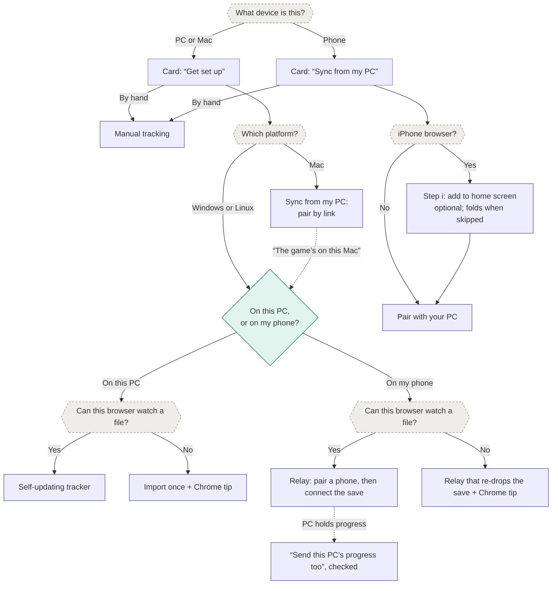
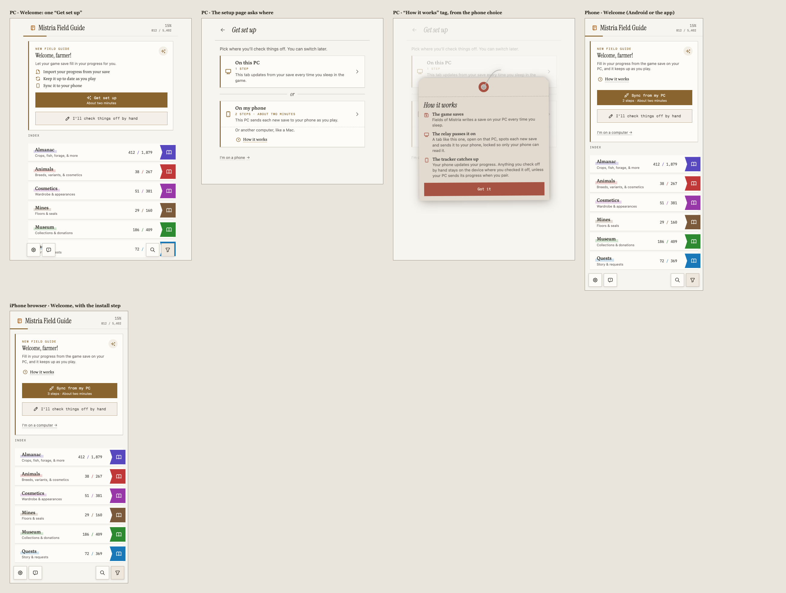
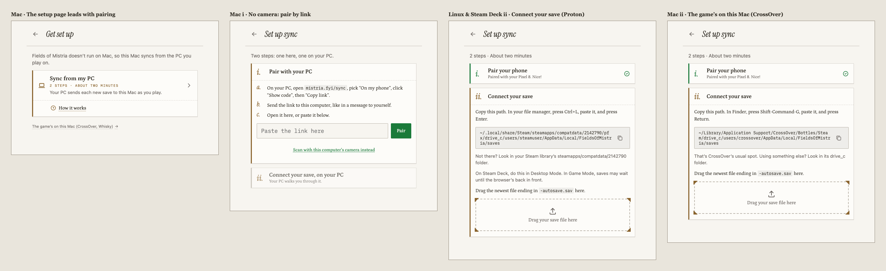
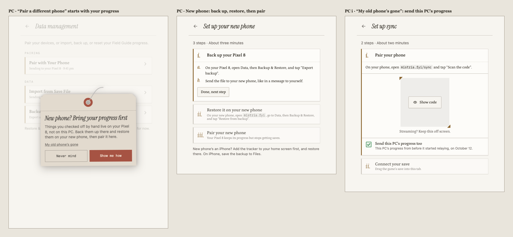
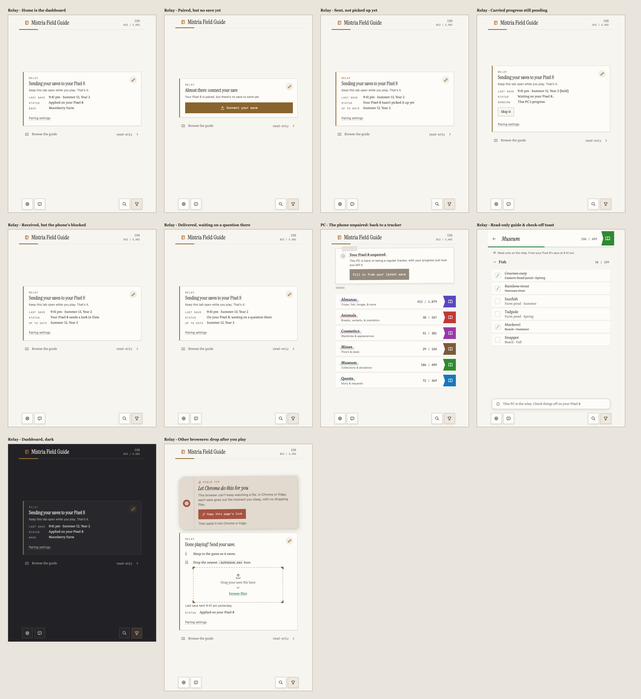
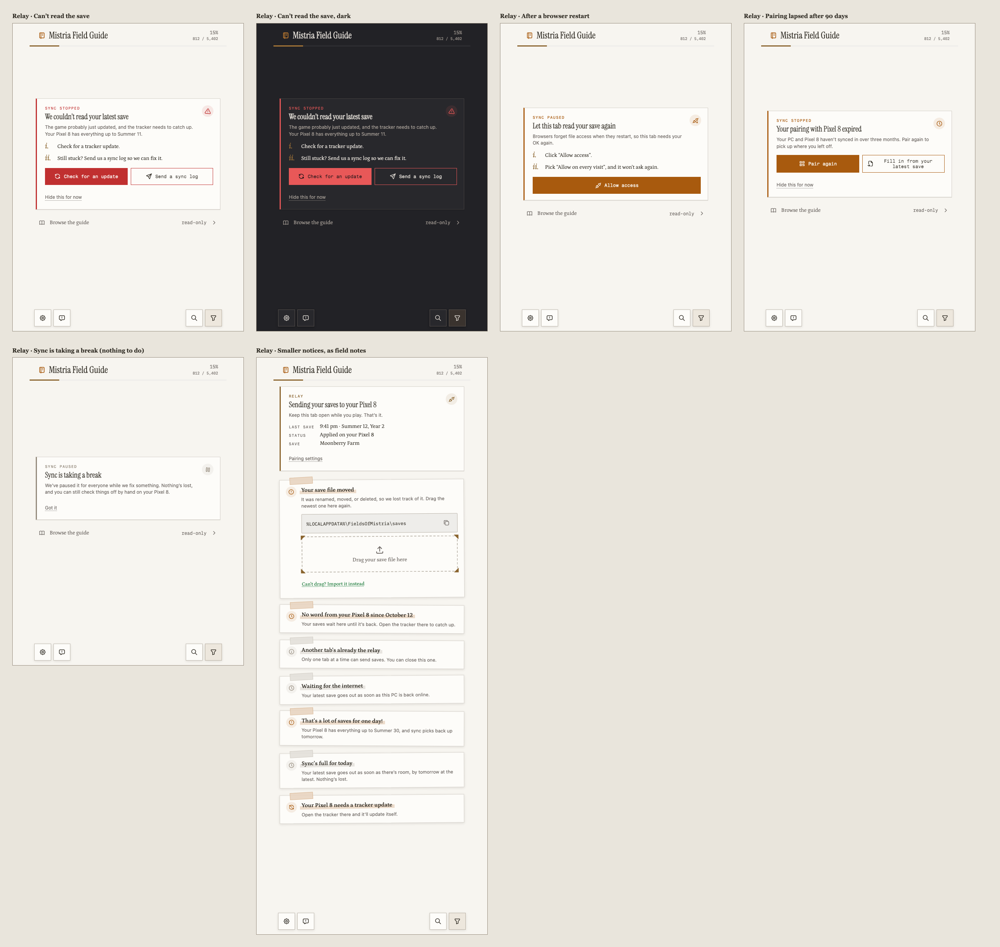
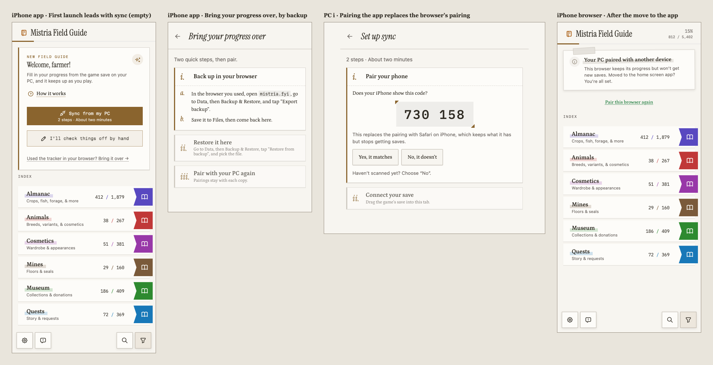
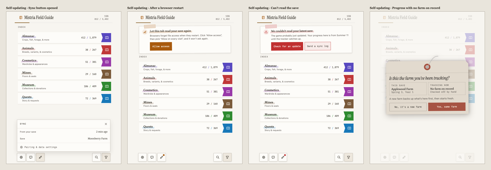

# Sync setup & pairing

tl;dr: The app detects what it can (device, platform, iPhone browser vs. installed app, whether the
browser can watch a file) and asks only what it can’t. Home invites with one card; all setup happens
on one page, `mistria.fyi/sync`, which Data also links to. On a PC that page asks one question: will
you check things off on this PC or on your phone? Each browser ends up in one role: a **tracker**, a
**self-updating tracker**, or a **relay**. This document is the journey, the screens, & the copy for
#131; the protocol is in [sync.md](sync.md).

Status: screens & copy in review on #131. Every state has a mockup on the
[design canvas](https://claude.ai/artifact/UhDfkQVf4Csu7eN9RcBStx); [Screens](#screens) embeds a
sheet per canvas row, from the [design package](design/sync-setup/README.md), which also holds the
generator & the review history. The happy path is approved; error & notice screens are first drafts.

## Mental model

Three parts, named the same way everywhere:

1. **The game** writes a save file on the PC each time you sleep (and when you load in).
2. **The relay**, a browser tab on that PC, watches the file & sends each new save onward.
3. **The tracker**, on your phone, receives it & updates your progress.

Sync moves the game’s save in one direction. Things checked off by hand stay on the device where
they were checked off, except once: when a PC that already holds progress pairs, it can send that
progress along (see [Carrying the PC’s progress](#carrying-the-pcs-progress)).

Player-facing names: “the game”, “your PC”, “your phone”, & “the tracker”. The PC tab calls itself
“the relay” only where its role matters (“This PC is the relay”).

## Roles

| Role                  | Where                   | Checks things off          | Gets progress from                           |
| --------------------- | ----------------------- | -------------------------- | -------------------------------------------- |
| Tracker (default)     | Any device              | Yes                        | Sync, a one-time import, or by hand          |
| Self-updating tracker | The PC running the game | Yes                        | Its own watched save                         |
| Relay                 | The PC running the game | No; the guide is read-only | Its own watched save, mirrored for reference |

- A browser is a tracker until setup makes it something else.
- **A relay never touches stored progress.** Whatever the browser had tracked stays in storage,
  untouched & hidden, while it relays. The read-only mirror lives in its own storage, outside stored
  progress & backups, and is discarded when the relay is turned off. Turning it off shows the stored
  progress again exactly as it was left.
- **A self-updating tracker** watches the save the same way a relay does but applies it locally,
  with no phone & no network. Check-offs are safe there, because nothing leaves the browser.
- **Why a relay doesn’t track.** If the PC tab took check-offs while relaying, they’d silently fail
  to reach the phone, which contradicts the mental model. A read-only mirror of the latest save
  keeps the guide useful on the PC without that trap. The relay already parses each save, so the
  mirror costs little.
- **The relay is a dashboard first.** In relay mode the app opens on a status dashboard: which
  phone, which save, when it last sent. Browsing the guide is a side trip from there. Trouble takes
  over that view and stays until dismissed, so a broken relay is hard to miss.

## First look

New players see the Home welcome card, which only invites; they can poke around first. The card’s
setup action opens `mistria.fyi/sync`, which does the work. “I’ll check things off by hand”
dismisses the card, as today.

- **On a PC,** the card lists what setup gets you (import your progress, keep it up to date, sync it
  to your phone) under one “Get set up” button, “About two minutes”. The card reads the same on
  Windows, Mac, & Linux.
- **On a phone,** the card’s button is “Sync from my PC”, with the step count on it (“2 steps ·
  About two minutes”, or “3 steps · About two minutes” in an iPhone browser), and “How it works”
  beside it.
- **The setup page asks one question on a PC:** “On this PC” (1 step) or “On my phone” (2 steps).
  The two paths are whole-card buttons with an “or” between them, so they read as exclusive. “How it
  works” sits with the phone path, the only one it explains, and opens a tag dialog.
- **The redesign drops WelcomeCard’s corner ring & accent wash.** The ring waits on #10’s marginalia
  decision; the Field Guide doesn’t otherwise use gradients.

### The decision tree

Diamonds are questions the player answers; hexagons are checks the app makes itself and never asks.

- **Import defaults to self-updating.** “On this PC” in a browser that can watch files gets the
  self-updating tracker without being asked; elsewhere it imports once, with the Chrome tip.
- **The choice is remembered,** and Data links back to the setup page. Every path stays reachable.
- **A Mac pairs like a phone.** Fields of Mistria has no Mac build, so a Mac is almost always where
  the player checks things off. A link covers CrossOver & Whisky players. A Linux PC or Steam Deck
  usually runs the game through Proton, so it gets the PC question.

### What the app can detect

| Check                     | How                                                                                                                                                 | Confidence                                |
| ------------------------- | --------------------------------------------------------------------------------------------------------------------------------------------------- | ----------------------------------------- |
| PC or phone               | User-Agent Client Hints `mobile` (Chrome & Edge only), plus a coarse pointer & screen size everywhere; “I’m on a computer” & “I’m on a phone” links | Heuristic; keep the overrides             |
| Platform                  | User-Agent Client Hints `platform`, else the user agent (`Windows`, `Macintosh` without touch, `Linux` or `X11` without `Android`)                  | Reliable; only picks defaults             |
| Installed or in a browser | `matchMedia("(display-mode: standalone)")`; `navigator.standalone` on iOS                                                                           | Reliable on iOS & Android                 |
| iPhone or iPad browser    | iOS user agent, or `Macintosh` with `navigator.maxTouchPoints > 1` (iPad Safari reports a Mac), & not standalone                                    | Reliable for iPhone; heuristic for iPad   |
| Can watch a file          | Feature checks for `FileSystemObserver` & drag-and-drop file handles                                                                                | Shows support only; behavior pending #130 |

- **Every iOS & iPadOS browser behaves like Safari here.** All of them, Firefox included, run on
  WebKit, and a home screen web app keeps its own storage apart from the browser that added it.
  Confirm on Firefox for iPhone during #130.
- **File watching is a capability check, not a promise.** A browser can have `FileSystemObserver`
  and still lose the file when the game replaces it instead of rewriting it; #130 checks that.
- **Android needs no install step.** An app installed from Chrome shares its storage with Chrome, so
  the data is already there.

### Why install on iPhone

A page can’t install itself on iOS, & `navigator.share` opens a share sheet without “Add to Home
Screen”, so the step gives instructions. Links, including Camera scans, open in the default browser,
never in the home screen app. The step still earns its place: Safari deletes a site’s script-written
storage after seven days of Safari use without visiting it, which would take progress & pairing keys
with it, while a home screen app keeps its own clock that only its own use resets. It also opens
full screen with its own icon. The step stays optional but recommended; #130 confirms the storage
behavior on current iOS.

## Save folders

| Platform                   | Folder                                                                                                              | How the step opens it                                 |
| -------------------------- | ------------------------------------------------------------------------------------------------------------------- | ----------------------------------------------------- |
| Windows                    | `%LOCALAPPDATA%\FieldsOfMistria\saves`                                                                              | Paste into File Explorer’s address bar, press Enter   |
| Linux & Steam Deck, Proton | `~/.local/share/Steam/steamapps/compatdata/2142790/pfx/drive_c/users/steamuser/AppData/Local/FieldsOfMistria/saves` | In the file manager, press Ctrl+L, paste, press Enter |
| Mac, CrossOver             | `~/Library/Application Support/CrossOver/Bottles/Steam/drive_c/users/crossover/AppData/Local/FieldsOfMistria/saves` | In Finder, press Shift-Command-G, paste, press Return |

Fields of Mistria’s Steam app ID is 2142790 ([SteamDB](https://steamdb.info/app/2142790/)). The
Proton & CrossOver paths, & Steam Deck’s browser, are unverified; #130 checks them. Other Wine
setups get “Look in its drive_c folder”.

- **Not every Steam keeps the default folder.** A game on a Steam Deck’s SD card lives under the
  card’s own `steamapps/compatdata/2142790/…`, & Flatpak Steam under
  `~/.var/app/com.valvesoftware.Steam/.local/share/Steam/…`. The Linux step adds a fallback line:
  “Not there? Look in your Steam library’s steamapps/compatdata/2142790 folder.”
- **A Flatpak browser may not see Steam’s folder at all** without a filesystem override, so a drop
  that never arrives falls back to import-once with the same line. #130 checks which browsers can.
- **Steam Deck setup happens in Desktop Mode,** where the browser runs; the step says so. Whether a
  relay keeps running beside a Game Mode game is a #130 check; until it passes, the step notes that
  saves may wait until the browser is back in front.

## Setup journey

Setup starts on whichever device the player is holding. Starting on the phone, it says to open
`mistria.fyi/sync` on the PC in Chrome or Edge; arriving there from a phone’s instructions, the PC
still asks its one question. Either way, pairing comes first, then the save. The phone scans with
the tracker’s own scanner, so the pairing lands in whichever copy the player is using.

| Step | On the PC                                                                                                       | On the phone                                                                                                                                              |
| ---- | --------------------------------------------------------------------------------------------------------------- | --------------------------------------------------------------------------------------------------------------------------------------------------------- |
| 1    | Picks “On my phone” on `mistria.fyi/sync`                                                                       | iPhone browser only: add to home screen, or skip                                                                                                          |
| 2    | Shows a covered code; “Show code” reveals it & “Copy link”                                                      | Taps “Scan the code” & scans, or “Or paste a link”                                                                                                        |
| 3    | Shows a six-digit code; the player confirms it matches (equal-weight buttons, “Haven’t scanned yet? Choose No”) | Shows the same code, then “You’re paired!”                                                                                                                |
| 4    |                                                                                                                 | If the PC’s progress is coming & the phone has its own, asks “Use my PC’s” or “Keep this phone’s”; a phone that gains progress later asks when it arrives |
| 5    | Connect the save: copy the folder path, drag the newest file in                                                 | Waits                                                                                                                                                     |
| 6    | Reads the transfer, checks the farm, then sends this PC’s progress, if checked & not declined                   | “Your PC’s progress is on its way…”                                                                                                                       |
| 7    | Sends the save                                                                                                  | “It worked!”: progress appears                                                                                                                            |
| 8    | Opens on the relay dashboard while the player plays                                                             | Updates each time the player sleeps in the game                                                                                                           |

Why pair first: the player sees success on the phone right away, and finishing the save step makes
progress appear on the phone moments later, which demonstrates the whole system once. The PC’s
progress waits for the save because the save names the farm being played (see
[Carrying the PC’s progress](#carrying-the-pcs-progress)).

- **Steps are cards.** The current step is open with an accent rule; done steps fold to one line
  with a green rule & check; later steps fold & fade. A skipped step folds to “Skipped. Add it any
  time.” with “Show me”, so it never vanishes. Steps that don’t apply (installing, off iPhone) are
  absent.
- **The Chrome tip.** In a browser that can’t watch a file & isn’t Chrome or Edge, a “Field tip”
  shipping tag sits above the steps: “Let Chrome do this for you”, with “Copy this page’s link”.
  Headlines say Chrome; body text says “Chrome or Edge”. It can’t be dismissed. A Chrome or Edge
  that fails the check gets no tip, only the import-once copy.
- **Copy follows the mode.** Promises of updates “every time you sleep” appear only where the save
  is watched; the import-once & re-drop paths say “whenever you drop it in” instead, on the PC & in
  the phone’s success note.
- **Drag only, where the save is watched.** Windows refuses the file picker under `%LOCALAPPDATA%`,
  & a picked file gives no handle to watch, so every watched drop box has no “browse files”: setup,
  “Your save file moved”, & Data’s “Use a different save”, each with the folder path to copy.
  Import-once & re-drop keep it. Each watched drop box has “Can’t drag? Import it instead”, a
  keyboard-reachable link that switches to re-drop with its honest copy, so the step never
  dead-ends. A keyboard path to a watched handle is a #130 check & a release gate for the watched
  path.
- **Every receiver can scan or paste.** “Scan the code” has “Or paste a link” under it, & a phone
  that can’t use its camera says so & shows the paste field. A link that doesn’t parse says “That
  link doesn’t look right” & keeps both. A link that opens the page shows “Pair with your PC?” &
  contacts the relay only after the tap, so a link scanner can’t spend the code.
- **Instructions name the PC’s question:** `sync_pc_open`: “On your PC, open {url} in Chrome or
  Edge, pick “On my phone”, and click “Show code”.”.
- **The match step resists a reflex “Yes”.** Both buttons have equal weight, with “Haven’t scanned
  yet? Choose “No”.” under them; once the other device answers, the PC’s copy names it (“Does your
  Mac show this code?”).
- **The Camera path on iPhone.** The Camera opens codes in the default browser, so a code that
  arrives that way asks “Pair this browser, or the app?” as a tag dialog, naming the browser it
  detects. “Pair {browser}” is primary, since most players have no app yet; “I’ll use the app”
  closes the dialog, which says to open the app & tap “Scan the code”, since a page can’t open it.
- **The install step brings progress along.** When the browser already tracks progress, step i adds
  “Already using the tracker here? Export a backup first” with “Export backup”, before “Open the
  tracker from there”, since the home screen app starts empty.
- **The install step names no browser.** “Tap Share. In Safari, it may be under •••.” covers
  Safari’s compact layout (iOS 26) & the other iOS browsers’ own Share menus.

### Pairing a computer

A Mac or a second PC has no camera aimed at the screen. With the code showing, the PC also offers
“Copy link”: the same offer URL the QR holds. The player sends it to the other computer however’s
easiest (“like in a message to yourself”) & opens it there, or pastes it into the setup page. It
arrives like a Camera-opened code, & the match code guards it the same way. “Scan with this
computer’s camera instead” stays as a fallback. Copying the link extends the offer to 10 minutes,
the PC shows the time left beside “Copy link”, & the QR covers itself again (see
[sync.md](sync.md#the-offer)). The PC’s choice reads “On my phone” with “Or another computer, like a
Mac.” on its own line after its body, and its copy names the device once one answers.

### Carrying the PC’s progress

When the PC holds progress, pairing shows “Send this PC’s progress too” under the code, checked on
the PC’s first pairing: “Sends what you’ve checked off here, once. Your phone asks before replacing
anything.” The PC sends that progress once through the sync channel, after the save is connected &
before the first save. This replaces exporting a backup on the PC & restoring it on the phone. See
[sync.md](sync.md#carrying-the-pcs-progress) &
[the decision record](decisions/2026-10-28-sync-carry-pc-progress.md).

- **The phone takes it whole or not at all.** An empty phone takes it without asking. A phone with
  progress asks right after “You’re paired!”, as a tag dialog: “Use my PC’s” (this phone’s progress
  is kept as a backup) or “Keep this phone’s”, with both farms side by side (“From your PC” & “On
  this phone”, by name & last in-game date, or “No farm on record”). When the backup slot already
  holds one, the dialog says it will be replaced. The PC can’t see the phone’s data before pairing,
  so it doesn’t ask. A phone that was empty at pairing but has gained progress by the time the carry
  arrives asks then.
- **The PC checks the farm first.** Once the save is connected, the PC compares it with its stored
  progress. Unidentified progress asks “Is this the farm you’ve been tracking?” on the PC; a
  different farm, or “No”, keeps the PC’s progress where it is & says “This PC’s progress stays
  here”, & the phone keeps what it has & gets the save. If the phone declined, the PC skips the
  check & says “Your {device} kept its own progress”.
- **Re-pairing shows it unchecked,** except after “My old phone’s gone”, which checks it. A relay’s
  stored progress is stale; a new phone gets its progress from the old phone instead (see
  [A new phone](#a-new-phone)).
- **Both devices show the wait.** The PC’s step reads “Sending your progress”, then “Waiting on your
  {device}…”, with “Skip it”, which drops the progress & lets saves through; the relay dashboard
  shows the same row if setup closes first. The phone shows “Your PC’s progress is on its way…”.
- **Every ending says which.** A phone with progress that used the PC’s says “Your PC’s progress is
  here” & names the backup in Data; an empty phone goes straight to “It worked!”, with no backup to
  name. A skip, or a farm the PC kept back, says “Your PC didn’t send its progress” & that the phone
  kept its own. A skip after the phone has started using it is refused on the PC (“Your {device} is
  already using it”) until 48 hours pass unconfirmed. A phone that can’t save the progress after
  claiming it says “Your PC’s progress couldn’t be saved here” & keeps its own; one on an older
  tracker asks to update & then takes it, while the PC says “Your {device} needs a tracker update”.
- **The PC’s stored progress stays where it is,** untouched, while it relays.

### When pairing can’t start

- **The robot check.** Turnstile runs invisibly each time the player reveals a code or asks for a
  new one. If it fails, the step shows “We couldn’t check you’re not a robot” with “Try again”, & no
  code.
- **Too many codes.** A PC that mints codes faster than the rate limit allows says “That’s a lot of
  codes” & to wait a few minutes.
- **Pairing is full today.** New pairings have a daily cap to keep sync free; the step says so,
  without a code, & that nothing’s lost.
- **Sync is paused or unreachable.** During the kill switch, both devices show “Sync is taking a
  break” in place of the code. When sync can’t be reached, the step shows “We couldn’t reach sync”
  with “Try again”.
- **A phone that can’t pair yet.** A phone whose stored progress is quarantined or from a newer
  build refuses to pair & sends the player to Data to sort it out first.
- **A relay or a self-updating PC can’t be paired to.** A pairing link opened on a relay says to
  unpair first, & on a self-updating tracker to stop updating first.

## Any time, not just first run

Every path stays reachable from Data, which links to the same setup page. Changing roles later:

- **Tracker or self-updating tracker → relay.** Setup offers to carry the PC’s progress, as above.
- **Tracker → self-updating tracker.** The first watched save applies through the apply rules
  (#129), like any sync, so earlier check-offs aren’t overwritten blindly.
- **Self-updating tracker → tracker.** “Stop updating” in Data forgets the save & keeps progress as
  it is.
- **Relay → tracker, by lapse.** A pairing that lapses ends the relay role, as unpairing does; the
  takeover offers “Pair again” & “Fill in from your latest save”.
- **An interrupted switch to relay** keeps the page read-only, saying “Finishing setup…”, until sync
  gives a definite answer; another tab’s check-off that lands after the switch says “That change
  didn’t save: this PC is the relay now.”.
- **Phone with progress → paired.** The first save applies through the apply rules (#135), asking
  “Is this the farm you’ve been tracking?” only when the phone’s progress has no farm on record.
- **Relay → tracker.** Unpairing discards the mirror and shows the stored progress exactly as it was
  left.
- **Relay → self-updating tracker.** Unpair first, then pick “On this PC”; the first watched save
  applies through the apply rules onto the progress from before relaying.
- **Paired phone → unpaired.** Unpairing keeps everything already on the phone, which says “Your PC
  unpaired this phone”; a PC whose phone unpaired says “Your {device} unpaired” & offers “Fill in
  from your latest save”.
- **Paired, but no save yet.** A relay abandoned after pairing shows “Almost there: connect your
  save”, with no progress counts in its header until a save arrives; the phone’s sync button shows a
  hairline slip, “Waiting for your first save”.

## A new phone

Manual check-offs live on the phone, not on the relay, so pairing a new phone from the PC alone
would leave them behind. “Pair a different phone” therefore opens a tag dialog first: “New phone?
Bring your progress first. Things you checked off by hand live on your {device}, not on this PC.”
with “Show me how” & a quieter “My old phone’s gone”.

1. **Back up the old phone.** On it, Data › Backup & Restore › “Export backup”, then send the file
   to the new phone however’s easiest.
2. **Restore it on the new phone.** Open `mistria.fyi`, Data › Backup & Restore › “Restore from
   backup”. A new iPhone adds the tracker to its home screen first & restores there, so the backup
   lands in the copy that pairs; the old iPhone saves its export to Files.
3. **Pair the new phone** with the PC, as usual. The old phone keeps its progress & stops getting
   saves.

The new phone is usually empty, but restore doesn’t assume it: when it already tracks progress,
restore asks “Replace what’s on this phone?” & keeps that progress as a backup first. “My old
phone’s gone” skips to pairing with “Send this PC’s progress too” checked & a note that it’s the
PC’s progress from before it started relaying, on {calendarDate}; a PC with no stored progress pairs
as usual, with no box. A one-time handoff code that skips the file is deferred to #269 (see
[the decision record](decisions/2026-10-28-sync-progress-handoff.md)).

## Data management

The page keeps its name: pairing moves data too, and “Settings” already names the toolbar gear’s
panel. Its intro becomes “Pair your devices, or import, back up, or reset your Field Guide
progress.” It regroups into two sections:

- **Pairing:** “Pair with Your Phone” on a PC (“Keep your phone up to date every time you play.”, or
  “Send your phone each save you drop in.” where the save is re-dropped) or “Pair with Your PC” on a
  phone (“Get each new save from your PC as you play.”). Open, it shows the device, the last save &
  its delivery status, “Pair a different phone”, & “Unpair”. Its setup button opens the setup page.
- **Data:** “Import from Save File” (which also hosts the self-updating state & the relay’s save,
  with “Use a different save”), “Backup & Restore” (“Keep a copy of your progress, or restore
  one.”), & “Danger Zone”. “Transfer to Another Device” stays until #138 removes it.
- **On a relay,** Data keeps only Pairing, Import (the relay’s save), & “Export backup”, which notes
  it’s this PC’s progress from before it started relaying. Restore & reset come back after
  unpairing, & a note says so.

Each card says why you’d pick it: pairing keeps a phone up to date, & a backup keeps a copy or moves
progress to a new device. Card titles stay in title case to match their siblings. Confirmations
(“New phone? Bring your progress first”, “Unpair your {device}?”) use the tag dialog.

## The relay dashboard

- The relay opens on its dashboard: one card, near the vertical middle of the page, so it reads as
  “this is all there is, & it’s working”. It names the phone, the last save, & where that save is:
  uploaded (“Your {device} hasn’t picked it up yet”), received & waiting on a question (“On your
  {device}, waiting on a question there”), received but blocked (“Your {device} needs a look in
  Data”), or applied (“Applied on your {device}”), with “Pairing settings”. “Up to date” names the
  last applied in-game date, never the last upload.
- While carried progress is pending, the status reads “Sending your progress” or “Waiting on your
  {device}…”, with “Skip it”.
- The header’s progress counts come from the mirror, so a relay with no save yet shows none.
- “Browse the guide” opens the full guide, read-only, mirroring the latest save, under the note
  “Read-only on the relay. From your {device}’s save at {time}.” Its checkboxes are drawn dashed &
  muted, so they don’t look live.
- Trying to check something off there shows a toast: “This PC is the relay. Check things off on your
  {device}.”
- Trouble takes over the card in amber, or red for errors (an unreadable save), until dismissed; a
  pause on our side is hairline, since there’s nothing to do. Red is the `--destructive` tone
  StatusNote already uses for errors.
- Start here and watch real use. If the read-only guide goes unused or only confuses, remove it and
  keep the dashboard alone.

## Status on the phone

Sync status lives in a quiet toolbar button beside settings & feedback. It speaks up only when
something is late or wrong: a colored dot, plus a short slip above it (“No saves in 5 days”, “Sync’s
taking a break”). Tapping it opens a compact panel in the toolbar-panel style: where progress comes
from, when, the last save’s date, & “Pairing & data settings”. The self-updating PC uses the same
button. Notices that need more than a slip are field notes on Home (below), including “New saves are
waiting” when the phone’s store becomes blocked after pairing.

### Tone & notices

- **Amber** needs you, **red** is an error, **green** is good news, & **hairline** is just so you
  know.
- Notices are field notes: a taped-in slip with a tilted icon marker & the app’s highlighter band
  under the title. Questions & confirmations use the tag dialog.
- The relay’s own notices (“Your save file moved”, “Another tab’s already the relay”, “Waiting for
  the internet”, “No word from your {device}”, the per-pairing & daily caps, & “needs a tracker
  update”) stack as field notes under its card.

## Moving to the installed app on iPhone

iOS keeps a browser’s data apart from the home screen app, so the app can’t move it.

- **First launch of the installed app leads with sync.** It opens on the phone welcome card (“Sync
  from my PC”), since most players install mid-setup & have nothing in the browser. “Used the
  tracker in your browser? Bring it over” is a secondary link.
- **Bringing it over is backup & restore.** In the browser, Data › Backup & Restore › “Export
  backup”, saved to Files; back in the app, “Restore from backup” & pick the file. Restore keeps
  provenance, & if the app already tracks progress, it asks before replacing & keeps a backup.
- **Then pair again from the app.** Pairing keys stay with each copy, so the app pairs fresh. With
  one phone per PC, the PC’s match step notes “This replaces the pairing with {device}” (“Safari on
  iPhone”). The browser shows “Your PC paired with another device”, says “Moved to the home screen
  app? You’re all set.”, & keeps what it has; pairing it again is a quiet link that goes through the
  PC’s match, which names what it replaces.

## Living with it

| Stage           | Relay (PC)                                                                                                                                         | Tracker (phone)                                                                                                                                                                                                                                           |
| --------------- | -------------------------------------------------------------------------------------------------------------------------------------------------- | --------------------------------------------------------------------------------------------------------------------------------------------------------------------------------------------------------------------------------------------------------- |
| Playing         | Dashboard open; nothing to do                                                                                                                      | Quiet sync button; its panel says when the last save came                                                                                                                                                                                                 |
| Away for days   | After 14 days without the phone, stops uploading & says so; the pairing lapses 90 days after the phone last checked in, & the PC becomes a tracker | Slip after an unusually long gap; after the lapse, a field note to re-pair                                                                                                                                                                                |
| Browser restart | Asks to re-allow reading the save (one click; “every visit” sticks)                                                                                | Nothing                                                                                                                                                                                                                                                   |
| Game update     | Can’t read the save: takes over the dashboard                                                                                                      | Keeps its last good progress; the panel’s date ages                                                                                                                                                                                                       |
| App update      | Reloads itself at a safe moment; “Your {device} needs a tracker update”                                                                            | Same; “Update the tracker on your PC” or “Update this phone”, naming the side that’s behind                                                                                                                                                               |
| New phone       | Points to backing up the old phone, then pairs the new one                                                                                         | The new phone restores the old one’s backup; the old one keeps its progress & stops getting saves                                                                                                                                                         |
| New farm        | Drop the new save                                                                                                                                  | Switches to the new farm & backs up the old one (“Switched to {newFarm}”); asks “Is this the farm you’ve been tracking?” only when its progress has no farm on record; a switch that would replace an earlier backup asks first (#135 owns that question) |
| Blocked store   | “Your {device} needs a look in Data”                                                                                                               | “New saves are waiting”, a field note pointing to Data                                                                                                                                                                                                    |
| Kill switch     | “Sync is taking a break”, hairline                                                                                                                 | Hairline dot & slip; tracking by hand still works                                                                                                                                                                                                         |
| Stop syncing    | “Unpair”: back to a tracker                                                                                                                        | Unpaired; keeps everything                                                                                                                                                                                                                                |
| Non-Chrome PC   | Re-drop the save after each session to send it                                                                                                     | Updates whenever a save is re-dropped                                                                                                                                                                                                                     |

The self-updating tracker lives with the same stages on one device: a browser restart asks to
re-allow reading the save, a game update shows the error in place of progress updates, & a new farm
switches with a backup, asking “Is this the farm you’ve been tracking?” only when the stored
progress has no farm on record, & asking first when the switch would replace an earlier backup (#135
owns that question).

## Accessibility

- **Focus follows the step.** When a step completes, focus moves to the next step’s title
  (`tabindex="-1"`); a step that fails keeps focus on its own title, with the error inside it.
  Opening a tag dialog focuses its title, & closing it returns focus to the control that opened it,
  or to the current step’s title for a dialog that opened by itself (the carry & Camera questions,
  the farm question).
- **Two live regions.** Setup has a polite region for step changes, the match code’s arrival, &
  results (“You’re paired!”, “It worked!”), & an assertive one for an error that blocks a step,
  announced once. Field notes already on a page when it loads are plain content, with no live role,
  so Home doesn’t re-announce them; one that appears during a visit is announced once through the
  live region.
- **The sync button says its state.** Its accessible name is “Sync: {status}” (“up to date”,
  “waiting for your first save”, “a question’s waiting”, “no saves in a while”, “paused”, or “needs
  a look”), so the dot & slip aren’t the only signal.
- **Targets.** Controls are at least 44 px tall on phones & 24 px elsewhere, with labels of 12 px or
  more; text links in step bodies sit in a 44 px row.
- **Read-only on the relay.** The guide’s checkboxes are `aria-disabled="true"`, drawn dashed &
  muted, & described by the read-only note. Activating one shows the toast, which is announced.
- **Codes.** The match code is labeled digit by digit, so a screen reader doesn’t read it as a
  number. The pairing code’s countdown updates on screen every second but announces only at one
  minute & at expiry.

## Visual direction

The screens use the app’s own pieces (the 512 px column, the Home header, DataCard, the tag dialog,
the toolbar & its panels, ui/button) so sync reads as part of the Field Guide, not a bolt-on.

- **Lowercase roman numerals** number steps, in the display face & home accent.
- **Photo-mount corners** frame what you hand over: the pairing code, the match code, & the drop
  box.
- **The tag dialog** carries every question & confirmation; **field notes** carry notices; the
  **Field tip** is an inline shipping tag.
- **Data & setup pages have no toolbar,** matching the app’s other utility pages.

## Voice

Write like a chill, non-judgmental friend helping with a tech setup.

- **Casual & warm.** Contractions, plain words, a little encouragement. Never blame the player.
- **Linear.** Every screen answers “what do I do now?” with numbered steps in order. Cut anything
  that isn’t a step or the reason for one.
- **One mental model.** Name the game, your PC, your phone, & the tracker consistently.
- **“Check off”, not “tick”,** matching the rest of the app.

## Screens

One sheet per canvas row, rendered from canvas version 51 & kept in the
[design package](design/sync-setup/README.md). PC boards are cropped to the 512 px column.

### First look

### Setup on the PC

### Setup on the phone

### Mac & Linux

### Setup hiccups

### Data management

### A new phone

### The relay dashboard

### When the relay needs you

### Living with it on the phone

### Moving to the iPhone app

### The self-updating tracker

## Copy

Keys follow [localization.md](localization.md#adding-a-new-ui-string-agents--humans): snake_case,
`sync_` for sync, in `messages/en.json` & every other locale. `{device}` is the paired device’s
derived name (“Pixel 8”), `{time}` a relative or clock time, `{gameDate}` an in-game date,
`{calendarDate}` a real one, `{farm}` & `{newFarm}` farm names, `{count}` & `{days}` counts (with
plural variants in inlang’s `match` form, as `search_results_count` does), `{browser}` the detected
browser (“Safari”), `{url}` the site address the string names (`mistria.fyi/sync` for pairing,
`mistria.fyi` for backup & restore), & `{suffix}` the save file’s ending (`-autosave.sav`), the last
two in `<code>`. Device names are short model names where the browser allows (“Pixel 8”, “iPhone”, &
“Safari on iPhone” for an iOS browser), so “your {device}” reads naturally; translators may
restructure those sentences around a label. The welcome card keeps `onboarding_overline` &
`onboarding_title`; the other `onboarding_*` descriptions & actions retire. The drop box reuses the
import card’s strings. Mode variants (`_redrop`) are text-only; their boards show the watched mode.
Error & notice copy is a first draft.

### Home & the setup page

| Key                             | English                                                                                                                                                                                        |
| ------------------------------- | ---------------------------------------------------------------------------------------------------------------------------------------------------------------------------------------------- |
| `sync_welcome_lead`             | Let your game save fill in your progress for you.                                                                                                                                              |
| `sync_welcome_feature_import`   | Import your progress from your save                                                                                                                                                            |
| `sync_welcome_feature_update`   | Keep it up to date as you play                                                                                                                                                                 |
| `sync_welcome_feature_phone`    | Sync it to your phone                                                                                                                                                                          |
| `sync_welcome_setup_action`     | Get set up                                                                                                                                                                                     |
| `sync_welcome_setup_time`       | About two minutes                                                                                                                                                                              |
| `sync_welcome_manual_action`    | I’ll check things off by hand                                                                                                                                                                  |
| `sync_welcome_phone_lead`       | Fill in your progress from the game save on your PC, and it keeps up as you play.                                                                                                              |
| `sync_welcome_phone_action`     | Sync from my PC                                                                                                                                                                                |
| `sync_step_count`               | Plural on `{count}`: one “{count} step”, other “{count} steps”; shown beside `sync_welcome_setup_time` (“About two minutes”) with a middle dot, as two strings, never joined into one sentence |
| `sync_how_it_works`             | How it works                                                                                                                                                                                   |
| `sync_switch_to_phone`          | I’m on a phone                                                                                                                                                                                 |
| `sync_switch_to_computer`       | I’m on a computer                                                                                                                                                                              |
| `sync_setup_title`              | Get set up                                                                                                                                                                                     |
| `sync_choose_lead`              | Pick where you’ll check things off. You can switch later.                                                                                                                                      |
| `sync_choice_here_title`        | On this PC                                                                                                                                                                                     |
| `sync_choice_here_body`         | This tab updates from your save every time you sleep in the game.                                                                                                                              |
| `sync_choice_here_body_import`  | Import your save, and drop it in again whenever you want to catch up.                                                                                                                          |
| `sync_choice_or`                | or                                                                                                                                                                                             |
| `sync_choice_phone_title`       | On my phone                                                                                                                                                                                    |
| `sync_choice_phone_body`        | This PC sends each new save to your phone as you play.                                                                                                                                         |
| `sync_choice_phone_body_redrop` | Drop your save here after you play, and this PC sends it to your phone.                                                                                                                        |
| `sync_choice_phone_other`       | Or another computer, like a Mac.                                                                                                                                                               |
| `sync_mac_lead`                 | Fields of Mistria doesn’t run on Mac, so this Mac syncs from the PC you play on.                                                                                                               |
| `sync_mac_choice_body`          | Your PC sends each new save to this Mac as you play.                                                                                                                                           |
| `sync_mac_game_here`            | The game’s on this Mac (CrossOver, Whisky)                                                                                                                                                     |

### How it works

| Key                          | English                                                                                                                                                         |
| ---------------------------- | --------------------------------------------------------------------------------------------------------------------------------------------------------------- |
| `sync_how_game_title`        | The game saves                                                                                                                                                  |
| `sync_how_game_body`         | Fields of Mistria writes a save on your PC every time you sleep.                                                                                                |
| `sync_how_relay_title`       | The relay passes it on                                                                                                                                          |
| `sync_how_relay_body`        | A tab like this one, open on that PC, spots each new save and sends it to your phone, locked so only your phone can read it.                                    |
| `sync_how_relay_body_redrop` | A tab like this one, open on that PC, sends each save you drop in to your phone, locked so only your phone can read it.                                         |
| `sync_how_phone_title`       | The tracker catches up                                                                                                                                          |
| `sync_how_phone_body`        | Your phone updates your progress. Anything you check off by hand stays on the device where you checked it off, unless your PC sends its progress when you pair. |
| `sync_how_done`              | Got it                                                                                                                                                          |

### Setup on the PC

| Key                                | English                                                                                                                      |
| ---------------------------------- | ---------------------------------------------------------------------------------------------------------------------------- |
| `sync_here_title`                  | Connect your save                                                                                                            |
| `sync_here_lead`                   | One step. After this, the tracker updates every time you sleep in the game.                                                  |
| `sync_import_title`                | Import your save                                                                                                             |
| `sync_import_lead`                 | One step. Drop your save in again whenever you want to catch up.                                                             |
| `sync_relay_title`                 | Set up sync                                                                                                                  |
| `sync_step_pair_phone`             | Pair your phone                                                                                                              |
| `sync_scan_intro`                  | On your phone, open {url} and tap “Scan the code”.                                                                           |
| `sync_show_code`                   | Show code                                                                                                                    |
| `sync_hide_code`                   | Hide code                                                                                                                    |
| `sync_code_stream_hint`            | Streaming? Keep this off screen.                                                                                             |
| `sync_code_expires`                | Good for {time}                                                                                                              |
| `sync_copy_link`                   | Copy link                                                                                                                    |
| `sync_link_copied`                 | Copied                                                                                                                       |
| `sync_copy_link_hint`              | Pairing a computer? Copy the link and open it there.                                                                         |
| `sync_code_expires_link`           | Link good for {time}                                                                                                         |
| `sync_code_label`                  | Pairing code                                                                                                                 |
| `sync_match_code_label`            | Matching code {digits}, with `{digits}` spaced one digit apart                                                               |
| `sync_send_progress`               | Send this PC’s progress too                                                                                                  |
| `sync_send_progress_hint`          | Sends what you’ve checked off here, once. Your phone asks before replacing anything.                                         |
| `sync_send_progress_old`           | This PC’s progress from before it started relaying, on {calendarDate}.                                                       |
| `sync_match_question`              | Does your {device} show this code?                                                                                           |
| `sync_match_yes`                   | Yes, it matches                                                                                                              |
| `sync_match_no`                    | No, it doesn’t                                                                                                               |
| `sync_match_not_yet`               | Haven’t scanned yet? Choose “No”.                                                                                            |
| `sync_match_replaces`              | This replaces the pairing with {device}, which keeps what it has but stops getting saves.                                    |
| `sync_paired_summary`              | Paired with your {device}. Nice!                                                                                             |
| `sync_step_save`                   | Connect your save                                                                                                            |
| `sync_step_save_summary`           | Drag the game’s save into this tab.                                                                                          |
| `sync_save_path_windows`           | Copy this path, paste it into File Explorer’s address bar, and press Enter.                                                  |
| `sync_save_path_linux`             | Copy this path. In your file manager, press Ctrl+L, paste it, and press Enter.                                               |
| `sync_save_path_linux_note`        | Not there? Look in your Steam library’s steamapps/compatdata/2142790 folder.                                                 |
| `sync_save_path_deck_note`         | On Steam Deck, do this in Desktop Mode.                                                                                      |
| `sync_save_path_deck_game_mode`    | In Game Mode, saves may wait until the browser’s back in front.                                                              |
| `sync_save_path_mac`               | Copy this path. In Finder, press Shift-Command-G, paste it, and press Return.                                                |
| `sync_save_path_mac_note`          | That’s CrossOver’s usual spot. Using something else? Look in its drive_c folder.                                             |
| `sync_copy_path`                   | Copy path                                                                                                                    |
| `sync_save_drag`                   | Drag the newest file ending in {suffix} here.                                                                                |
| `sync_save_no_drag`                | Can’t drag? Import it instead                                                                                                |
| `sync_save_redrop_note`            | Here, drop your save in again after each time you play.                                                                      |
| `sync_sending`                     | Sending your save to your {device}…                                                                                          |
| `sync_sending_progress`            | Sending your progress                                                                                                        |
| `sync_waiting_on_device`           | Waiting on your {device}…                                                                                                    |
| `sync_waiting_on_device_hint`      | Your saves go out as soon as your phone has this. Phone in a pocket? Open the tracker there.                                 |
| `sync_skip_progress`               | Skip it                                                                                                                      |
| `sync_skip_refused`                | Your {device} is already using it                                                                                            |
| `sync_skip_refused_body`           | Your saves go out as soon as it’s done.                                                                                      |
| `sync_pc_farm_note`                | If it’s a different farm, this PC’s progress stays here, and your phone keeps what it has and gets the save.                 |
| `sync_progress_stays_title`        | This PC’s progress stays here                                                                                                |
| `sync_progress_stays_body`         | It’s for {farm}, and you’re playing {newFarm}, so it stays on this PC. Your phone keeps what it has and gets the save.       |
| `sync_progress_stays_body_unnamed` | It doesn’t match the save you’re playing, so it stays on this PC. Your phone keeps what it has and gets the save.            |
| `sync_device_kept_own_title`       | Your {device} kept its own progress                                                                                          |
| `sync_device_kept_own_body`        | So this PC’s progress stays here, and your saves go out as usual.                                                            |
| `sync_fenced_write`                | That change didn’t save: this PC is the relay now.                                                                           |
| `sync_finishing_setup`             | Finishing setup…                                                                                                             |
| `sync_finishing_setup_body`        | This page is read-only until sync confirms the pairing.                                                                      |
| `sync_tip_overline`                | Field tip                                                                                                                    |
| `sync_tip_title`                   | Let Chrome do this for you                                                                                                   |
| `sync_tip_body`                    | This browser can’t keep watching a file. In Chrome or Edge, each save goes out the moment you sleep, with no dropping files. |
| `sync_tip_action`                  | Copy this page’s link                                                                                                        |
| `sync_tip_after`                   | Then paste it into Chrome or Edge.                                                                                           |

### Setup on the phone & other computers

| Key                             | English                                                                                                                              |
| ------------------------------- | ------------------------------------------------------------------------------------------------------------------------------------ |
| `sync_phone_lead`               | Two steps: one here, one on your PC.                                                                                                 |
| `sync_phone_lead_ios`           | Three steps: two here, one on your PC.                                                                                               |
| `sync_step_install`             | Add it to your home screen                                                                                                           |
| `sync_install_share`            | Tap Share. In Safari, it may be under •••.                                                                                           |
| `sync_install_add`              | Tap “Add to Home Screen”.                                                                                                            |
| `sync_install_open`             | Open the tracker from there to keep going.                                                                                           |
| `sync_install_backup_first`     | Already using the tracker here? Export a backup first.                                                                               |
| `sync_install_open_restore`     | Open the tracker from there, and restore the backup in Data.                                                                         |
| `sync_install_skip`             | Skip, keep using {browser}                                                                                                           |
| `sync_install_skipped`          | Skipped. Add it any time.                                                                                                            |
| `sync_install_show`             | Show me                                                                                                                              |
| `sync_step_pair_pc`             | Pair with your PC                                                                                                                    |
| `sync_step_pair_pc_summary`     | Scan a code from your PC.                                                                                                            |
| `sync_pc_open`                  | On your PC, open {url} in Chrome or Edge, pick “On my phone”, and click “Show code”.                                                 |
| `sync_scan_action`              | Scan the code                                                                                                                        |
| `sync_paste_link`               | Or paste a link                                                                                                                      |
| `sync_step_save_on_pc`          | Connect your save, on your PC                                                                                                        |
| `sync_step_save_on_pc_hint`     | Your PC walks you through it.                                                                                                        |
| `sync_check_pc`                 | Check your PC. It should show this code:                                                                                             |
| `sync_confirm_there`            | Confirm it there, and you’re paired.                                                                                                 |
| `sync_waiting_pc`               | Waiting for your PC…                                                                                                                 |
| `sync_paired_with_pc`           | Paired with your PC                                                                                                                  |
| `sync_paired_title`             | You’re paired!                                                                                                                       |
| `sync_paired_body`              | Now connect your save on your PC. Your progress shows up here as soon as it’s done.                                                  |
| `sync_paired_progress_body`     | Now connect your save on your PC. Your PC’s progress comes over first, then each new save.                                           |
| `sync_carry_title`              | Your PC has progress to send                                                                                                         |
| `sync_carry_body`               | This phone has progress too. Use your PC’s, and we’ll keep a backup of what’s here. Or keep this phone’s, and your PC’s stays there. |
| `sync_carry_from_pc`            | From your PC                                                                                                                         |
| `sync_carry_on_phone`           | On this phone                                                                                                                        |
| `sync_replaces_backup`          | This replaces your backup of {farm}, from {calendarDate}.                                                                            |
| `sync_replaces_backup_unnamed`  | This replaces your earlier backup, from {calendarDate}.                                                                              |
| `sync_carry_use`                | Use my PC’s                                                                                                                          |
| `sync_carry_keep`               | Keep this phone’s                                                                                                                    |
| `sync_carry_skipped_title`      | Your PC didn’t send its progress                                                                                                     |
| `sync_carry_skipped_body`       | This phone kept its own, and new saves still come in.                                                                                |
| `sync_carry_skipped_body_empty` | This phone starts from your save, and new saves still come in.                                                                       |
| `sync_carry_failed_title`       | Your PC’s progress couldn’t be saved here                                                                                            |
| `sync_carry_failed_body`        | This phone kept its own, and new saves still come in. To bring your PC’s over later, export a backup on your PC and restore it here. |
| `sync_progress_coming`          | Your PC’s progress is on its way…                                                                                                    |
| `sync_progress_keep_open`       | It comes over once your PC connects its save.                                                                                        |
| `sync_waiting_save`             | Waiting for your first save…                                                                                                         |
| `sync_worked_title`             | It worked!                                                                                                                           |
| `sync_worked_body`              | Your progress is here, and it updates every time you sleep in the game.                                                              |
| `sync_worked_body_redrop`       | Your progress is here, and it updates whenever your PC sends a new save.                                                             |
| `sync_worked_action`            | Take a look                                                                                                                          |
| `sync_camera_title`             | Pair this browser, or the app?                                                                                                       |
| `sync_camera_body`              | Your camera opened this code in {browser}. Using the tracker from your home screen? Open it there and tap “Scan the code” instead.   |
| `sync_camera_pair`              | Pair {browser}                                                                                                                       |
| `sync_camera_app`               | I’ll use the app                                                                                                                     |
| `sync_link_copy`                | On your PC, open {url}, pick “On my phone”, click “Show code”, then “Copy link”.                                                     |
| `sync_link_send`                | Send the link to this computer, like in a message to yourself.                                                                       |
| `sync_link_open`                | Open it here, or paste it below.                                                                                                     |
| `sync_link_placeholder`         | Paste the link here                                                                                                                  |
| `sync_link_confirm_title`       | Pair with your PC?                                                                                                                   |
| `sync_link_confirm_body`        | Pair, then check the code on your PC.                                                                                                |
| `sync_link_confirm_action`      | Pair                                                                                                                                 |
| `sync_link_pair`                | Pair                                                                                                                                 |
| `sync_link_camera`              | Scan with this computer’s camera instead                                                                                             |
| `sync_bad_link_title`           | That link doesn’t look right                                                                                                         |
| `sync_bad_link_body`            | It may have been cut off. Copy it again on your PC, or scan the code instead.                                                        |

### Setup hiccups

| Key                          | English                                                                                                         |
| ---------------------------- | --------------------------------------------------------------------------------------------------------------- |
| `sync_expired_title`         | That code timed out                                                                                             |
| `sync_expired_body`          | Codes last a couple of minutes. Grab a new one when your phone’s ready.                                         |
| `sync_expired_action`        | New code                                                                                                        |
| `sync_no_match_title`        | No worries, nobody’s paired                                                                                     |
| `sync_no_match_body`         | Show a new code and scan it again.                                                                              |
| `sync_scanned_first_title`   | Someone else got to this code first                                                                             |
| `sync_scanned_first_body`    | On your PC, click “No, it doesn’t”, then show a new code and scan it again.                                     |
| `sync_scan_again`            | Scan again                                                                                                      |
| `sync_too_slow_title`        | That took a while                                                                                               |
| `sync_too_slow_body`         | The code expired before your PC confirmed it, so nobody’s paired. Show a new code on your PC and scan it again. |
| `sync_wrong_file_title`      | Hmm, that’s not a save file                                                                                     |
| `sync_wrong_file_body`       | Look for one ending in {suffix}.                                                                                |
| `sync_camera_denied_title`   | We can’t use your camera                                                                                        |
| `sync_camera_denied_body`    | Allow camera access in your browser’s settings, or copy the link from your PC and paste it here.                |
| `sync_code_spent_title`      | That code’s expired                                                                                             |
| `sync_code_spent_body`       | On your PC, show a new code, then scan or paste again.                                                          |
| `sync_offline_setup_title`   | You’re offline                                                                                                  |
| `sync_offline_setup_body`    | Pairing needs the internet. We’ll pick up where you left off once you’re back.                                  |
| `sync_check_failed_title`    | We couldn’t check you’re not a robot                                                                            |
| `sync_check_failed_body`     | That happens sometimes. Try again, and if it keeps failing, reload the page.                                    |
| `sync_try_again`             | Try again                                                                                                       |
| `sync_too_many_codes_title`  | That’s a lot of codes                                                                                           |
| `sync_too_many_codes_body`   | Give it a few minutes, then show a new code.                                                                    |
| `sync_setup_break_body`      | We’ve paused sync for everyone while we fix something. Try again later; nothing’s lost.                         |
| `sync_unreachable_title`     | We couldn’t reach sync                                                                                          |
| `sync_unreachable_body`      | Check your connection, then try again.                                                                          |
| `sync_relay_no_answer_title` | This PC is the relay                                                                                            |
| `sync_relay_no_answer`       | Unpair it in Data first to pair it with another device.                                                         |
| `sync_self_no_answer_title`  | This PC updates itself from your save                                                                           |
| `sync_self_no_answer`        | Stop updating in Data first to pair it with another device.                                                     |
| `sync_pairing_full_title`    | Pairing is full for today                                                                                       |
| `sync_pairing_full_body`     | Lots of farmers set up sync today, and we cap new pairings to keep it free. Try again tomorrow; nothing’s lost. |
| `sync_store_blocked_title`   | This phone can’t pair yet                                                                                       |
| `sync_store_blocked_body`    | Its saved progress needs a look first. Open Data to sort it out, then come back.                                |
| `sync_store_blocked_action`  | Open Data                                                                                                       |

### Data management

| Key                              | English                                                                                                                                         |
| -------------------------------- | ----------------------------------------------------------------------------------------------------------------------------------------------- |
| `data_intro` (changed)           | Pair your devices, or import, back up, or reset your Field Guide progress.                                                                      |
| `sync_data_pairing`              | Pairing                                                                                                                                         |
| `sync_data_data`                 | Data                                                                                                                                            |
| `sync_pair_phone_title`          | Pair with Your Phone                                                                                                                            |
| `sync_pair_phone_summary`        | Keep your phone up to date every time you play.                                                                                                 |
| `sync_pair_phone_summary_redrop` | Send your phone each save you drop in.                                                                                                          |
| `sync_pair_pc_title`             | Pair with Your PC                                                                                                                               |
| `sync_pair_pc_summary`           | Get each new save from your PC as you play.                                                                                                     |
| `sync_pair_sending`              | Sending to your {device} · {time}                                                                                                               |
| `sync_pair_intro`                | Pair a phone, and this tab sends it each new save while you play. Two steps, about two minutes.                                                 |
| `sync_pair_intro_redrop`         | Pair a phone, and this tab sends it each save you drop in. Two steps, about two minutes.                                                        |
| `sync_pair_setup`                | Set up pairing                                                                                                                                  |
| `sync_label_phone`               | Phone                                                                                                                                           |
| `sync_label_pc`                  | PC                                                                                                                                              |
| `sync_label_save`                | Save                                                                                                                                            |
| `sync_label_status`              | Status                                                                                                                                          |
| `sync_label_up_to_date`          | Up to date                                                                                                                                      |
| `sync_status_uploaded`           | Your {device} hasn’t picked it up yet                                                                                                           |
| `sync_status_question`           | On your {device}, waiting on a question there                                                                                                   |
| `sync_status_blocked`            | Your {device} needs a look in Data                                                                                                              |
| `sync_label_sending`             | Sending                                                                                                                                         |
| `sync_sending_pc_progress`       | This PC’s progress                                                                                                                              |
| `sync_save_held`                 | {gameDate} (held)                                                                                                                               |
| `sync_status_applied`            | Applied on your {device}                                                                                                                        |
| `sync_label_last_save`           | Last save                                                                                                                                       |
| `sync_label_updated`             | Updated                                                                                                                                         |
| `sync_checked_in`                | {device} · checked in {time}                                                                                                                    |
| `sync_pair_different`            | Pair a different phone                                                                                                                          |
| `sync_unpair`                    | Unpair                                                                                                                                          |
| `sync_unpair_keeps`              | You’ll keep everything on this phone.                                                                                                           |
| `sync_import_sending`            | Sending {farm} to your {device}                                                                                                                 |
| `sync_import_updating`           | Updating from your save · {time}                                                                                                                |
| `sync_use_different_save`        | Use a different save                                                                                                                            |
| `sync_use_different_cancel`      | Cancel                                                                                                                                          |
| `sync_stop_updating`             | Stop updating                                                                                                                                   |
| `sync_relay_backup_summary`      | Export a backup of this PC’s progress, from before it started relaying.                                                                         |
| `sync_relay_data_note`           | Restore & reset come back when you unpair, since this PC only relays for now.                                                                   |
| `backup_card_summary` (changed)  | Keep a copy of your progress, or restore one.                                                                                                   |
| `sync_new_phone_title`           | New phone? Bring your progress first                                                                                                            |
| `sync_new_phone_body`            | Things you checked off by hand live on your {device}, not on this PC. Back them up there and restore them on your new phone, then pair it here. |
| `sync_new_phone_cancel`          | Never mind                                                                                                                                      |
| `sync_new_phone_confirm`         | Show me how                                                                                                                                     |
| `sync_new_phone_gone`            | My old phone’s gone                                                                                                                             |
| `sync_new_phone_steps_title`     | Set up your new phone                                                                                                                           |
| `sync_new_phone_time`            | About three minutes                                                                                                                             |
| `sync_new_phone_backup`          | Back up your {device}                                                                                                                           |
| `sync_new_phone_backup_how`      | On your {device}, open Data, then Backup & Restore, and tap “Export backup”.                                                                    |
| `sync_new_phone_send`            | Send the file to your new phone, like in a message to yourself.                                                                                 |
| `sync_new_phone_restore`         | Restore it on your new phone                                                                                                                    |
| `sync_new_phone_restore_how`     | On your new phone, open {url}, go to Data, then Backup & Restore, and tap “Restore from backup”.                                                |
| `sync_new_phone_ios`             | New phone’s an iPhone? Add the tracker to your home screen first, and restore there.                                                            |
| `sync_new_phone_files`           | On iPhone, save the backup to Files.                                                                                                            |
| `sync_restore_replace_title`     | Replace what’s on this phone?                                                                                                                   |
| `sync_restore_replace_body`      | We’ll keep a backup of what’s here first.                                                                                                       |
| `sync_restore_replace_action`    | Replace                                                                                                                                         |
| `sync_restore_replace_cancel`    | Never mind                                                                                                                                      |
| `sync_new_phone_next`            | Done, next step                                                                                                                                 |
| `sync_new_phone_pair`            | Pair your new phone                                                                                                                             |
| `sync_new_phone_pair_hint`       | Your {device} keeps its progress but stops getting saves.                                                                                       |
| `sync_unpair_title`              | Unpair your {device}?                                                                                                                           |
| `sync_unpair_body`               | This tab goes back to being a regular tracker, with your progress just how you left it. Your {device} keeps everything it has.                  |
| `sync_unpair_cancel`             | Keep syncing                                                                                                                                    |

### The relay

| Key                          | English                                                                              |
| ---------------------------- | ------------------------------------------------------------------------------------ |
| `sync_relay_overline`        | Relay                                                                                |
| `sync_relay_heading`         | Sending your saves to your {device}                                                  |
| `sync_relay_body`            | Keep this tab open while you play. That’s it.                                        |
| `sync_pairing_settings`      | Pairing settings                                                                     |
| `sync_browse_guide`          | Browse the guide                                                                     |
| `sync_read_only`             | read-only                                                                            |
| `sync_guide_read_only`       | Read-only on the relay. From your {device}’s save at {time}.                         |
| `sync_relay_toast`           | This PC is the relay. Check things off on your {device}.                             |
| `sync_no_save_title`         | Almost there: connect your save                                                      |
| `sync_no_save_body`          | Your {device} is paired, but there’s no save to send yet.                            |
| `sync_device_unpaired_title` | Your {device} unpaired                                                               |
| `sync_device_unpaired_body`  | This PC is back to being a regular tracker, with your progress just how you left it. |
| `sync_fill_from_save`        | Fill in from your latest save                                                        |
| `sync_redrop_title`          | Done playing? Send your save.                                                        |
| `sync_redrop_sleep`          | Sleep in the game so it saves.                                                       |
| `sync_redrop_drop`           | Drop the newest {suffix} here.                                                       |
| `sync_redrop_last`           | Last save sent {time}.                                                               |
| `sync_quiet_title`           | No word from your {device} since {calendarDate}                                      |
| `sync_quiet_body`            | Your latest save waits here until it’s back. Open the tracker there to catch up.     |
| `sync_full_title`            | Sync’s full for today                                                                |
| `sync_full_body`             | Your latest save goes out tomorrow, when sync resets. Nothing’s lost.                |
| `sync_hide_for_now`          | Hide this for now                                                                    |

### Trouble & notices

| Key                         | English                                                                                                                           |
| --------------------------- | --------------------------------------------------------------------------------------------------------------------------------- |
| `sync_stopped_overline`     | Sync stopped                                                                                                                      |
| `sync_paused_overline`      | Sync paused                                                                                                                       |
| `sync_unreadable_title`     | We couldn’t read your latest save                                                                                                 |
| `sync_unreadable_body`      | The game probably just updated, and the tracker needs to catch up. Your {device} has everything up to {gameDate}.                 |
| `sync_unreadable_self_body` | The game probably just updated. Your progress here is from {gameDate} until the tracker catches up.                               |
| `sync_unreadable_update`    | Check for a tracker update.                                                                                                       |
| `sync_unreadable_log`       | Still stuck? Send us a sync log so we can fix it.                                                                                 |
| `sync_check_update`         | Check for an update                                                                                                               |
| `sync_send_log`             | Send a sync log                                                                                                                   |
| `sync_reallow_title`        | Let this tab read your save again                                                                                                 |
| `sync_reallow_body`         | Browsers forget file access when they restart, so this tab needs your OK again.                                                   |
| `sync_reallow_click`        | Click “Allow access”.                                                                                                             |
| `sync_reallow_every_visit`  | Pick “Allow on every visit”, and it won’t ask again.                                                                              |
| `sync_reallow_action`       | Allow access                                                                                                                      |
| `sync_lapsed_title`         | Your pairing with {device} expired                                                                                                |
| `sync_lapsed_body`          | Your PC and {device} haven’t synced in over three months. Pair again to pick up where you left off.                               |
| `sync_pair_again`           | Pair again                                                                                                                        |
| `sync_break_title`          | Sync is taking a break                                                                                                            |
| `sync_break_body`           | We’ve paused it for everyone while we fix something. Nothing’s lost, and you can still check things off by hand on your {device}. |
| `sync_break_ok`             | Got it                                                                                                                            |
| `sync_moved_title`          | Your save file moved                                                                                                              |
| `sync_moved_body`           | It was renamed, moved, or deleted, so we lost track of it. Drag the newest one here again.                                        |
| `sync_other_tab_title`      | Another tab’s already the relay                                                                                                   |
| `sync_other_tab_body`       | Only one tab at a time can send saves. You can close this one.                                                                    |
| `sync_offline_title`        | Waiting for the internet                                                                                                          |
| `sync_offline_body`         | Your latest save goes out as soon as this PC is back online.                                                                      |
| `sync_daily_cap_title`      | That’s a lot of saves for one day!                                                                                                |
| `sync_daily_cap_body`       | Your {device} has everything up to {gameDate}, and sync picks back up tomorrow.                                                   |
| `sync_device_behind_title`  | Your {device} needs a tracker update                                                                                              |
| `sync_device_behind_body`   | Open the tracker there and it’ll update itself.                                                                                   |

### Status on the phone

| Key                               | English                                                                                                                        |
| --------------------------------- | ------------------------------------------------------------------------------------------------------------------------------ |
| `sync_toolbar_label`              | Sync: {status}                                                                                                                 |
| `sync_panel_title`                | Sync                                                                                                                           |
| `sync_toolbar_status_ok`          | up to date                                                                                                                     |
| `sync_toolbar_status_waiting`     | waiting for your first save                                                                                                    |
| `sync_toolbar_status_question`    | a question’s waiting                                                                                                           |
| `sync_toolbar_status_late`        | no saves in a while                                                                                                            |
| `sync_toolbar_status_paused`      | paused                                                                                                                         |
| `sync_toolbar_status_attention`   | needs a look                                                                                                                   |
| `sync_panel_from_pc`              | From your PC                                                                                                                   |
| `sync_panel_from_save`            | From your save                                                                                                                 |
| `sync_panel_settings`             | Pairing & data settings                                                                                                        |
| `sync_slip_gap`                   | Plural on `{days}`: one “No saves in {days} day”, other “No saves in {days} days”                                              |
| `sync_slip_break`                 | Sync’s taking a break                                                                                                          |
| `sync_slip_waiting`               | Waiting for your first save                                                                                                    |
| `sync_phone_lapsed_title`         | Your pairing expired                                                                                                           |
| `sync_phone_lapsed_body`          | Your PC and this phone haven’t synced in over three months. Pair again to keep going.                                          |
| `sync_pc_behind_title`            | Update the tracker on your PC                                                                                                  |
| `sync_pc_behind_body`             | Reload the sync tab there, and you’re good.                                                                                    |
| `sync_phone_behind_title`         | Update this phone                                                                                                              |
| `sync_phone_behind_body`          | Your PC is on a newer tracker. Close and reopen the tracker here to update it.                                                 |
| `sync_replaced_title`             | Your PC paired with another device                                                                                             |
| `sync_replaced_body`              | This phone keeps its progress but won’t get new saves.                                                                         |
| `sync_replaced_body_ios`          | This browser keeps its progress but won’t get new saves. Moved to the home screen app? You’re all set.                         |
| `sync_replaced_action`            | Pair this phone again                                                                                                          |
| `sync_replaced_action_ios`        | Pair this browser again                                                                                                        |
| `sync_unpaired_by_pc_title`       | Your PC unpaired this phone                                                                                                    |
| `sync_unpaired_by_pc_body`        | Everything here stays. Pair again any time from Data.                                                                          |
| `sync_phone_blocked_title`        | New saves are waiting                                                                                                          |
| `sync_phone_blocked_body`         | This phone’s saved progress needs a look before they can come in. Open Data to sort it out.                                    |
| `sync_carry_applied_title`        | Your PC’s progress is here                                                                                                     |
| `sync_carry_applied_body`         | We kept a backup of this phone’s progress for {farm}. Restore it any time from Data.                                           |
| `sync_carry_applied_body_unnamed` | We kept a backup of what was on this phone. Restore it any time from Data.                                                     |
| `sync_farm_title`                 | Is this the farm you’ve been tracking?                                                                                         |
| `sync_farm_this_save`             | This save                                                                                                                      |
| `sync_farm_tracking`              | Tracking now                                                                                                                   |
| `sync_switched_title`             | Switched to {newFarm}                                                                                                          |
| `sync_switched_body`              | We saved a backup of {farm}. Restore it any time from Data.                                                                    |
| `sync_switched_body_unnamed`      | We saved a backup of your earlier progress. Restore it any time from Data.                                                     |
| `sync_farm_on_pc`                 | On this PC                                                                                                                     |
| `sync_farm_none`                  | No farm on record                                                                                                              |
| `sync_farm_by_hand`               | Checked off by hand                                                                                                            |
| `sync_farm_note`                  | A new farm backs up what’s here first, then starts fresh.                                                                      |
| `sync_farm_new`                   | No, it’s a new farm                                                                                                            |
| `sync_farm_same`                  | Yes, same farm                                                                                                                 |
| `sync_self_reallow_body`          | Browsers forget file access when they restart. Click “Allow access”, then pick “Allow on every visit”, and it won’t ask again. |

### Moving to the iPhone app

| Key                     | English                                                                                          |
| ----------------------- | ------------------------------------------------------------------------------------------------ |
| `sync_move_title`       | Bring your progress over                                                                         |
| `sync_app_bring_link`   | Used the tracker in your browser? Bring it over                                                  |
| `sync_move_lead`        | Two quick steps, then pair.                                                                      |
| `sync_move_export`      | Back up in your browser                                                                          |
| `sync_move_export_how`  | In the browser you used, open {url}, go to Data, then Backup & Restore, and tap “Export backup”. |
| `sync_move_export_save` | Save it to Files, then come back here.                                                           |
| `sync_move_restore`     | Restore it here                                                                                  |
| `sync_move_restore_how` | Go to Data, then Backup & Restore, tap “Restore from backup”, and pick the file.                 |
| `sync_move_pair`        | Pair with your PC again                                                                          |
| `sync_move_pair_hint`   | Pairings stay with each copy.                                                                    |

## Decisions so far

- The app detects what it can and asks only the rest; the flowchart marks which is which.
- Home invites with one card on every platform; all setup happens on `mistria.fyi/sync`, which Data
  also links to. A PC’s only question is “On this PC” or “On my phone”, drawn as two exclusive
  paths.
- “How it works” sits with the phone path, the only one it explains.
- Every path is available on first run & any time later from Data.
- A relay defaults to its dashboard, centered, with a read-only guide behind it and a toast on
  check-off attempts; the guide gets removed if real use shows it isn’t useful.
- One phone per relay. Several trackers wouldn’t sync with each other, and supporting that would be
  a major revision of the protocol.
- The self-updating tracker gets its own issue (#252), as new scope for #123.
- The platform picks defaults only: Linux & Steam Deck get the PC flow with the Proton path, & a Mac
  pairs like a phone, by link. The switch links override.
- A shown pairing code also offers “Copy link”, the same offer URL, for computers without a camera.
- A PC with progress carries it over the sync channel once, after the save is connected, checked by
  default on a first pairing. The PC sends it only for the farm being played, & the phone takes it
  whole or keeps its own; nothing merges (changed after round two). See
  [the decision record](decisions/2026-10-28-sync-carry-pc-progress.md).
- A new phone, or the iPhone app, gets its progress from the old copy by backup & restore, since the
  receiving copy is usually empty, & restore asks before replacing anything; “Pair a different
  phone” starts there, with “My old phone’s gone” as the way out. A handoff code is deferred to
  #269. See [the decision record](decisions/2026-10-28-sync-progress-handoff.md).
- On iPhone, installing is optional step i of setup, recommended for Safari’s storage limits, &
  folds when skipped. The installed app’s first launch leads with sync setup, with bringing the
  browser’s progress over (by backup & restore) as a secondary link.
- Pairing is confirmed by matching a six-digit code shown on both devices, derived from the
  handshake, so a leaked code can’t silently redirect sync. See
  [the decision record](decisions/2026-10-27-sync-pairing-confirm.md).
- The pairing code starts covered; showing it mints the offer, & hiding it doesn’t restart it.
- Device names derive locally from the browser and only label a pairing; they never decide anything.
  Renaming is out of scope for v1.
- An iOS or iPadOS browser can pair like any phone; moving to the installed app re-pairs from the
  app, as part of the migration. A code opened from the Camera asks which copy to pair, & can only
  say how to open the app, not open it.
- A relay leaves stored progress untouched; its mirror lives apart & is discarded on unpair.
- Data management keeps its name & regroups into Pairing & Data; the relay’s save lives in the
  Import card, not the pairing card.
- Status lives in a quiet toolbar button that speaks up only when late or wrong. Amber needs you,
  red is an error, green is good news, & hairline is just so you know.
- Notices are field notes; questions & confirmations are tag dialogs; the Chrome tip is a Field tip.
