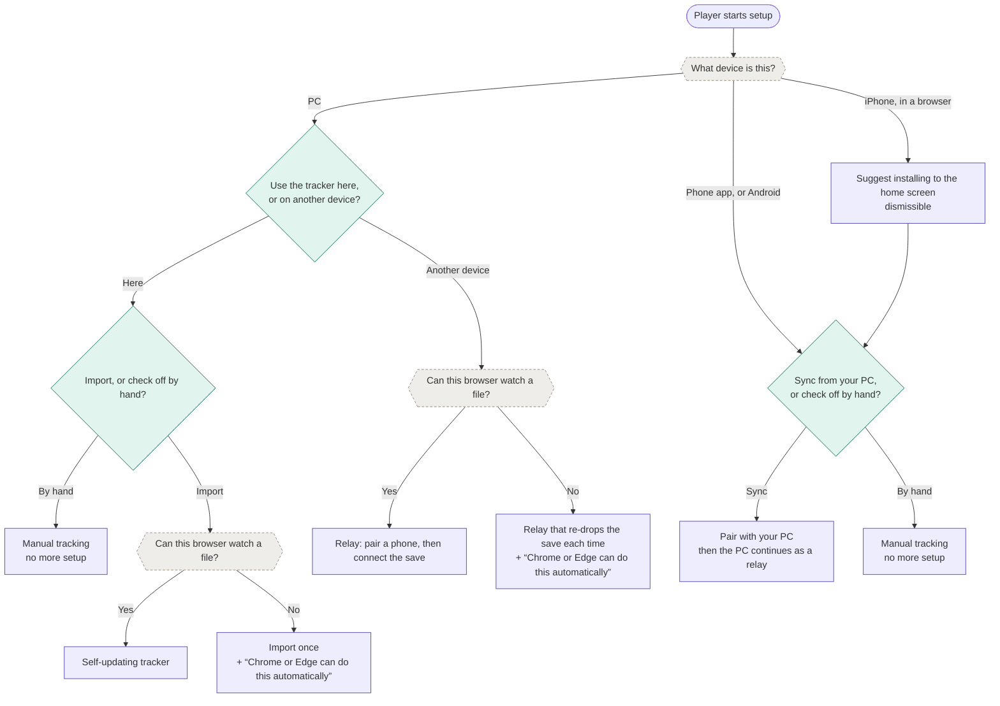
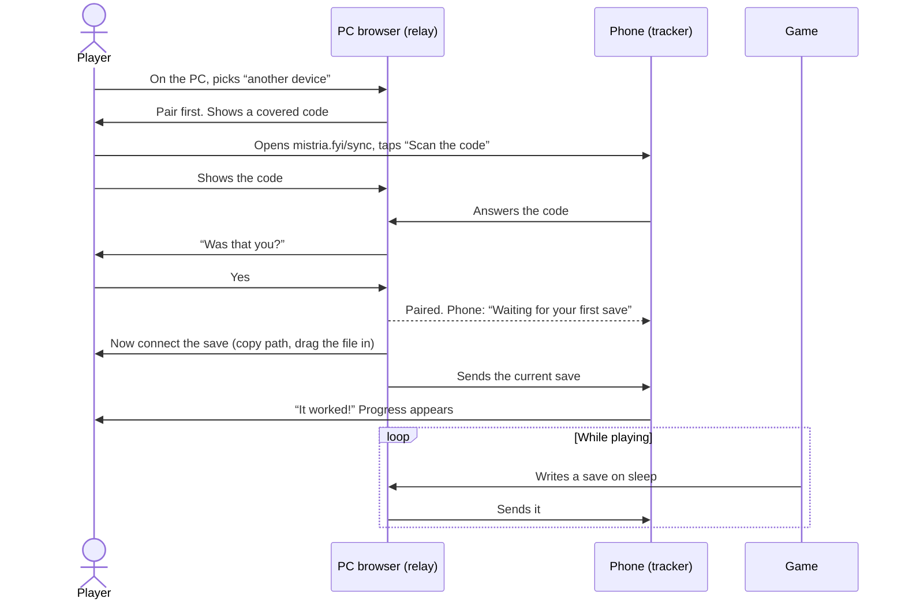

# Sync setup & pairing

tl;dr: The app detects what it can (device kind, iPhone browser vs. installed app, whether the
browser can watch a file) and asks only what it can’t: on a PC, whether you’ll use the tracker here
or on another device; on a phone, whether to sync or check things off by hand. Each browser ends up
in one role: a **tracker**, a **self-updating tracker**, or a **relay**. This document is the
journey & decision flow for #131; the protocol is in [sync.md](sync.md). UI & copy wait until the
flow is settled.

Status: flow in review on #131. The
[design canvas](https://claude.ai/artifact/UhDfkQVf4Csu7eN9RcBStx) is paused at an earlier flow; its
visual direction (lowercase roman numerals for steps, photo-mount corners on the drop box & code)
carries forward.

## Mental model

Three parts, named the same way everywhere:

1. **The game** writes a save file on the PC each time you sleep (and when you load in).
2. **The relay**, a browser tab on that PC, watches the file & sends each new save onward.
3. **The tracker**, on your phone, receives it & updates your progress.

Sync moves the game’s save, and only the save, in one direction. Anything checked off by hand stays
on the device where it was checked off.

## Roles

| Role                  | Where                   | Checks things off          | Gets progress from                           |
| --------------------- | ----------------------- | -------------------------- | -------------------------------------------- |
| Tracker (default)     | Any device              | Yes                        | Sync, a one-time import, or by hand          |
| Self-updating tracker | The PC running the game | Yes                        | Its own watched save                         |
| Relay                 | The PC running the game | No; the guide is read-only | Its own watched save, mirrored for reference |

- A browser is a tracker until setup makes it something else. Turning a relay off makes it a tracker
  again, with whatever progress it had before.
- **A self-updating tracker** watches the save the same way a relay does but applies it locally,
  with no phone & no network. Check-offs are safe there, because nothing leaves the browser.
- **Why a relay doesn’t track.** If the PC tab took check-offs while relaying, they’d silently fail
  to reach the phone, which contradicts the mental model. A read-only mirror of the latest save
  keeps the guide useful on the PC without that trap. The relay already parses each save, so the
  mirror costs little.
- **The relay is a station, not a page.** In relay mode the app opens on a relay status view: which
  phone, which save, when it last sent. Browsing the guide is a side trip from there. Trouble takes
  over that view and stays until dismissed, so a broken relay is hard to miss.

## First look: the decision tree

The tree runs on first run (onboarding) & from Data. Diamonds are questions the player answers;
hexagons are checks the app makes itself and never asks.

- **Import defaults to self-updating.** A player who picks “import” on a PC that can watch files
  gets the self-updating tracker without being asked; the one-time import is the fallback.
- **The installed-app nudge is dismissible.** A player can keep using the tracker in the browser;
  the nudge only explains that the browser & the home screen app don’t share data.
- **“How it works”** (the mental model) sits beside the first question, collapsed but clearly
  labeled. Curious players open it; ready players skip it.
- **The choice is remembered,** and Data leads with it. The other paths stay one tap away.
- **One-time import moves under “Just this once”,** so players can tell it won’t update on its own.

### What the app can detect

| Check                     | How                                                                                                                         | Confidence                         |
| ------------------------- | --------------------------------------------------------------------------------------------------------------------------- | ---------------------------------- |
| PC or phone               | User-Agent Client Hints `mobile`, a coarse pointer, & screen size; onboarding already has an override (“I’m on a computer”) | Heuristic; keep the override       |
| Installed or in a browser | `matchMedia("(display-mode: standalone)")`; `navigator.standalone` on iOS                                                   | Reliable on iOS & Android          |
| iPhone browser            | iOS user agent & not standalone                                                                                             | Reliable                           |
| Can watch a file          | Feature checks for `FileSystemObserver` & drag-and-drop file handles                                                        | Reliable; Firefox & Safari fail it |

- **Every iOS browser behaves like Safari here.** All iOS browsers, Firefox included, run on WebKit,
  and a home screen web app keeps its own storage apart from the browser that added it. Confirm on
  Firefox for iPhone during #130.
- **Android needs no nudge.** An app installed from Chrome shares its storage with Chrome, so the
  data is already there. Installing stays optional.

## Sync setup journey

Setup starts on whichever device the player is holding, and both paths converge on the same order:
pair first, then connect the save. `mistria.fyi/sync` is the address either device names for the
other.

Why pair first: the player sees success on the phone immediately, and the moment they finish
connecting the save, progress lands on the phone, which demonstrates the whole system once.

## Living with it

| Stage           | Relay (PC)                                                          | Tracker (phone)                                                            |
| --------------- | ------------------------------------------------------------------- | -------------------------------------------------------------------------- |
| Playing         | Station view open; nothing to do                                    | “Updated from your PC {time ago}” stamp                                    |
| Away for days   | Pairing lapses after 14 days unseen; station says to re-pair        | Toast on open after an unusually long gap: is the relay still open?        |
| Browser restart | Asks to re-allow reading the save (one click; “every visit” sticks) | Nothing                                                                    |
| Game update     | Can’t read the save: takes over the station view                    | Keeps its last good progress; stamp ages                                   |
| App update      | Reloads itself at a safe moment                                     | Same; a version mismatch names the device that’s behind                    |
| New phone       | Pair again; the old phone stops receiving                           | Old phone keeps its progress; new one gets the next save                   |
| New farm        | Drop the new save                                                   | Asks “Is this the farm you’ve been tracking?”; backs up the old one (#135) |
| Kill switch     | “Sync is taking a break”                                            | Same; tracking by hand still works                                         |
| Stop syncing    | “Turn off sync”: back to a tracker                                  | Unpaired; keeps everything                                                 |

## Open questions

1. **Relay read-only mirror.** Recommendation above: yes. The alternative is hiding the guide in
   relay mode, which is simpler but makes the PC tab less useful.
2. **Can a relay serve more than one tracker?** sync.md fixes one phone per PC. A tablet & a phone
   together would need a protocol change.
3. **Steam Deck.** It’s a PC running Linux, often with touch, so device detection may call it a
   phone. The override covers it until #130 says how its browsers behave.
4. **The self-updating tracker is new scope** for the epic (#123). It reuses the relay’s watching &
   the importer, with no network; it needs its own issue once this flow is approved.

## Voice

When UI & copy resume, write like a chill, non-judgmental friend helping with a tech setup.

- **Casual & warm.** Contractions, plain words, a little encouragement. Never blame the player.
- **Linear.** Every screen answers “what do I do now?” with numbered steps in order. Cut anything
  that isn’t a step or the reason for one.
- **One mental model.** Name the game, the relay, & the tracker consistently (player-facing names to
  be chosen with the UI).
- **“Check off”, not “tick”,** matching the rest of the app.

## Decisions so far

- The PC confirms whoever scans the code, so a leaked code can’t silently redirect sync. See
  [the decision record](decisions/2026-10-27-sync-pairing-confirm.md).
- The pairing code starts covered; showing it is deliberate.
- Device names derive locally from the browser; renaming is out of scope for v1.
