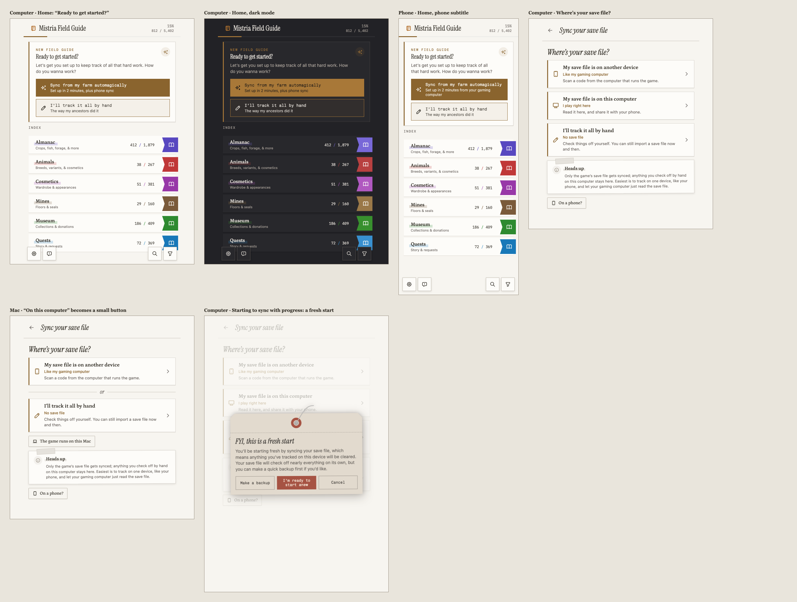
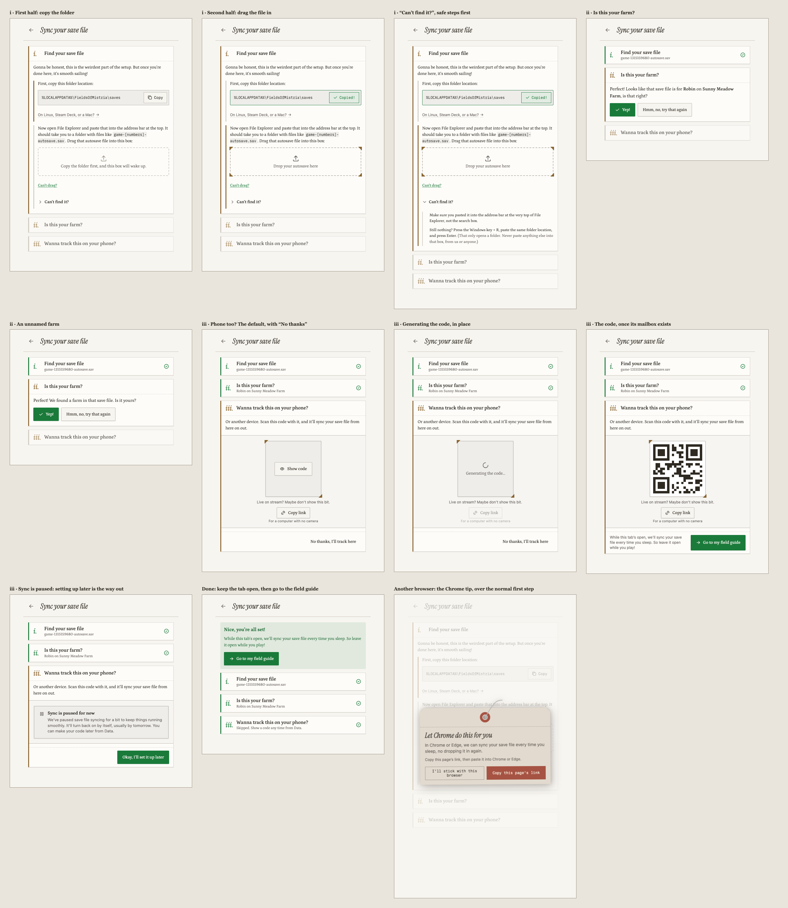
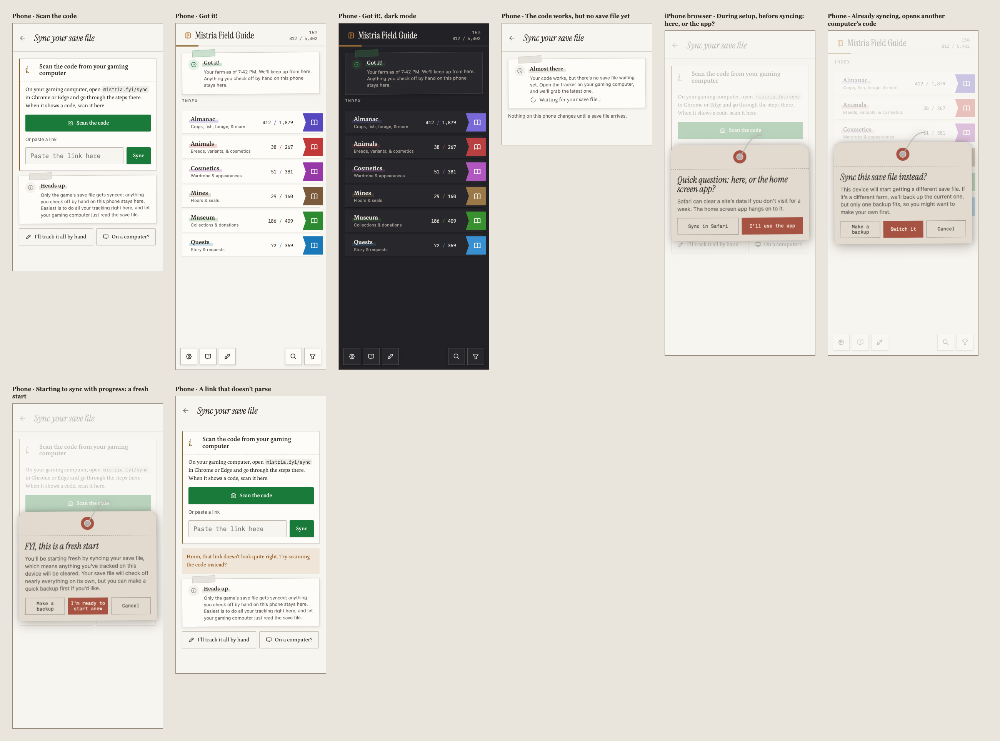
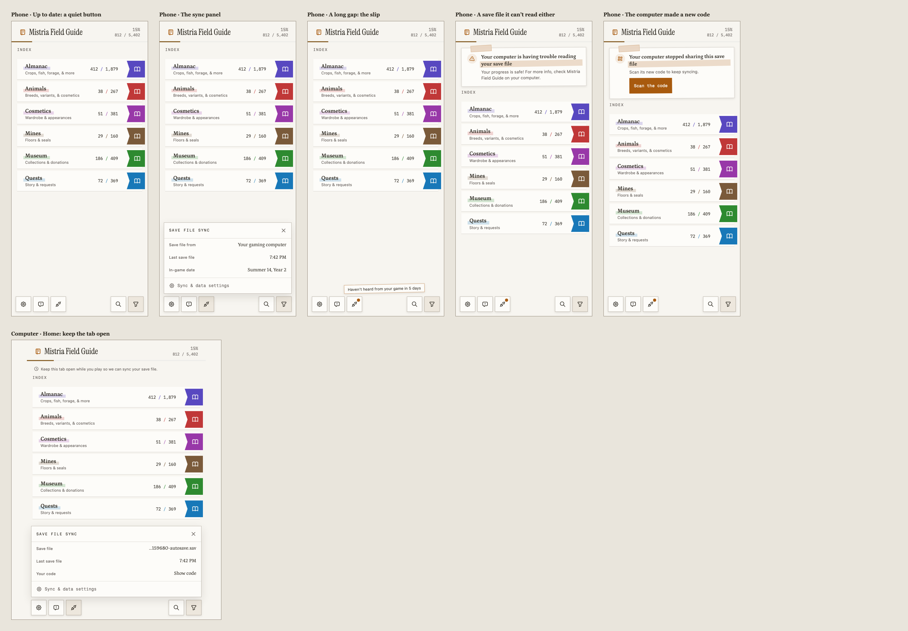
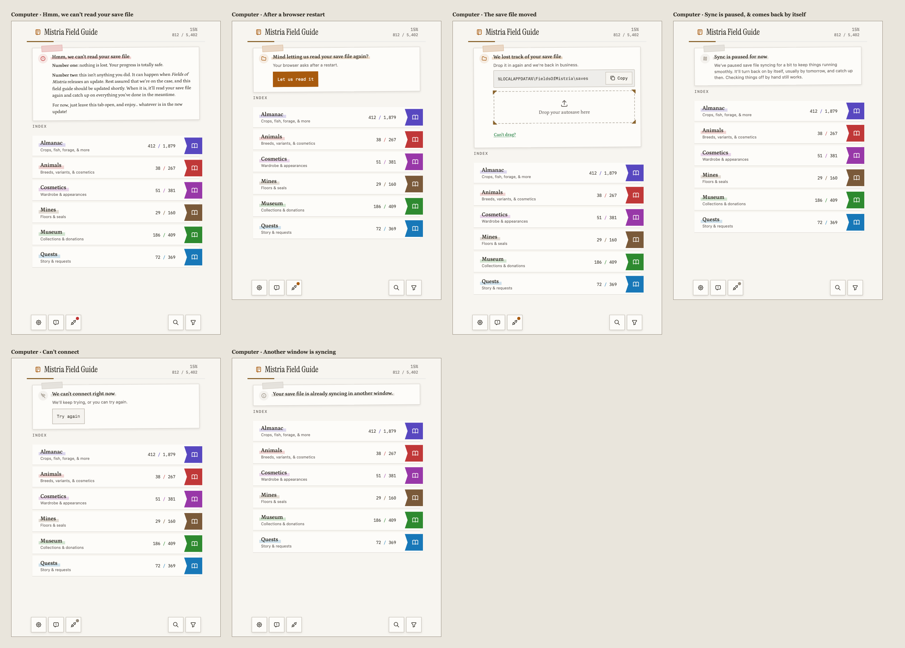
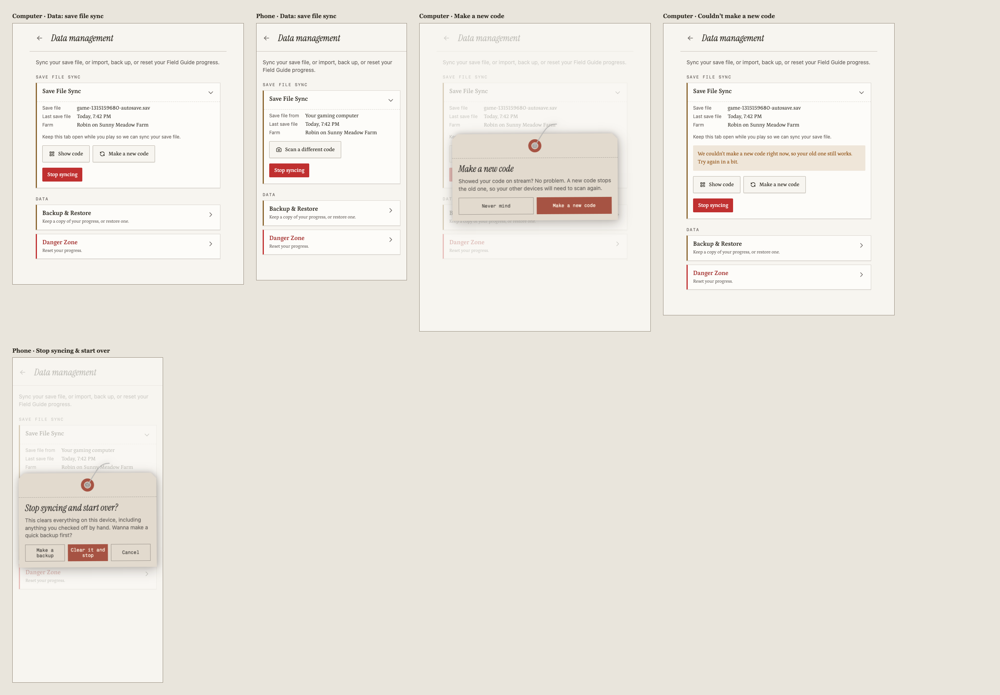

# Sync setup

tl;dr: Setup is one file & maybe one QR code. On the gaming computer, the player copies a folder
path, drags their autosave in, confirms it’s their farm, & (by default) shows a code for their
phone. Every device is in one of three lanes: its save file is on this computer, its save file is on
another device, or it tracks by hand. Only the game’s save file syncs; anything checked off by hand
stays on the device where it was checked off. Starting to sync erases the device, so syncing always
starts fresh; stopping keeps everything. This document is the journey, the screens, & the copy for
#131; the protocol is in [sync.md](sync.md), & the reasons are in
[the decision record](decisions/2026-10-28-sync-follow-the-save.md).

Status: journey, copy, & mockups approved by the maintainer on #131 (2026-10-28), after two design
review rounds on PR #275. Every main state has a board on the
[design canvas](https://claude.ai/artifact/5MG6rDBdx4HqjGmQyBbjrD); [Screens](#screens) embeds a
sheet per row from the [design package](design/sync-setup/README.md). Not drawn, & specified only
here & in the copy table: the Linux & Mac folder views, “Show code” from Data (the same code area as
setup), the version-update notices, the blocked-store notice, the one-year expired code, & the
farm’s “try that again” hint. This replaces the pairing design explored on #251.

## Mental model

1. **The game** writes a save file on the gaming computer each time you sleep (and when you load
   in).
2. **Syncing your save file** reads it & updates the tracker. The gaming computer reads its own save
   file & shares a code; any other device can scan the code & sync the same save file.
3. **Only the save file syncs.** Anything you check off by hand stays on the device where you
   checked it off. It’s never sent anywhere.

The easiest pattern, which the copy nudges toward without enforcing: track on one device (usually
the phone), & let the gaming computer just read the save file.

## Voice

A chill friend helping with a two-minute job: casual, warm, a little goofy, & never technical. Most
players upload one file & maybe scan a code, so no screen should feel like a technical journey. The
maintainer’s samples on #131 set the tone, & [voice.md](voice.md) now holds it for the whole app.
For sync in particular:

- **Speak as “we”,** & talk to the player directly. Contractions & loose spellings are fine
  (“gonna”, “wanna”).
- **Be honest about effort, then reassure.** “Gonna be honest, this is the weirdest part of the
  setup. But once you’re done here, it’s smooth sailing!”
- **Explain the why** in a sentence when it helps. Longer & kinder beats terse & cryptic.
- **Playful asides** belong in parentheses & button subtitles (“the way my ancestors did it”).
- **Use the player’s world:** their farmer, their farm, _Fields of Mistria_.
- **“Sync” travels with “save file”** wherever copy explains what happens (“sync your save file”,
  “only the game’s save file gets synced”), so it keeps reinforcing what syncs & what doesn’t. Short
  labels on a screen that already said it, like “Stop syncing”, & the Home card’s invitation can
  stand alone. Never “pair”, “relay”, or “follow” in player copy, & “link” only where the player
  copies, pastes, or opens one.
- **Reassure on errors in this order:** nothing is lost, it isn’t your fault, here’s what happens
  next. Never promise a precise time.
- **Remind the gaming computer to stay open,** often: at success, in its status, & on its errors.
- **“Check off”, not “tick”,** matching the rest of the app.

## Lanes

| Lane                        | Where                           | Progress comes from                              | Check-offs by hand        |
| --------------------------- | ------------------------------- | ------------------------------------------------ | ------------------------- |
| Save file on this computer  | The computer that runs the game | Its own save file, watched (or dropped in again) | Allowed; stay on this one |
| Save file on another device | Any other device                | The latest save file from the gaming computer    | Allowed; stay on this one |
| By hand (default)           | Any device                      | Check-offs, one-time imports, & backups          | Everything                |

- **One lane per device.** “Device” means one browser profile, or one installed app on iPhone, since
  iOS keeps those apart.
- **Every device starts by hand,** which is today’s tracker.
- **Starting to sync starts fresh.** Joining either syncing lane, including joining again later,
  erases the device’s progress first, since syncing starts from the save file. The dialog offers a
  backup every time. This is the v1 rule, chosen over merging or carrying progress between lanes.
- **Stopping keeps everything.** Leaving a syncing lane for tracking by hand keeps progress as it
  is, since it’s already here; from then on it’s tracked by hand. There’s no direct move between the
  two syncing lanes: stop syncing, then set up again, which starts fresh.
- **A lane starts when the first save file applies.** The erase lands in the same write, & nothing
  is stored before it, so a setup that fails, finds no save file, or is abandoned changes nothing.
- **Within a lane, nothing is lost.** Scanning a different code, a new farm, & restoring a backup
  all stay in the lane; the next save file applies with the usual rules (a new farm switches with a
  backup of the old one).
- **What a syncing lane hides.** Data’s “Import from Save File” & the transfer card, since the save
  file already arrives by itself. Backup & restore, & check-offs by hand, stay.

### What stays by hand

The save file fills every category the tracker has. A few things it can’t settle, so syncing never
removes them, & the player sets them by hand:

- Choosing not to have children: a childless save cannot distinguish refusing from postponing, so
  the player’s recorded choice stays. Positive child evidence, relationship changes, the break-ups
  setting, pregnancy quests, & the Mistmare’s appearances follow the save file under the usual
  [sync apply rules](sync.md#completeness).

The erase dialog & the “only the save file syncs” notes can say “nearly everything” honestly.

## What the app detects

Four checks. They choose which options & copy appear; none of them picks a lane for the player.

| Check                         | How                                                                                                          | Effect                                                                        |
| ----------------------------- | ------------------------------------------------------------------------------------------------------------ | ----------------------------------------------------------------------------- |
| A computer, not a phone       | User-Agent Client Hints `mobile` where supported, else no iOS or Android in the user agent, & a fine pointer | Shows “My save file is on this computer”; picks computer or phone copy        |
| A Mac                         | `Macintosh` in the user agent without touch                                                                  | Downplays that option to a small button, since the game has no Mac build      |
| Can this browser watch a file | Feature checks for `FileSystemObserver` & drop handles                                                       | “Every time you sleep”, or “Drop it in again after you play” & the Chrome tip |
| iPhone or iPad browser        | iOS user agent, or `Macintosh` with touch, & not standalone                                                  | The home screen question before syncing                                       |

The computer check is a heuristic, so the sync page keeps “On a computer?” & “On a phone?” overrides
at the bottom.

## Getting started

- **Home’s welcome card** asks “Ready to get started?” with two whole-card buttons, each with a
  subtitle:
  - “Sync from my farm automagically” (“Set up in 2 minutes, plus phone sync” on a computer, “Set up
    in 2 minutes from your gaming computer” on a phone), which opens `mistria.fyi/sync`.
  - “I’ll track it all by hand” (“The way my ancestors did it”), which dismisses the card, as today.
- **The sync page,** which Data also links to, asks “Where’s your save file?” on a computer:
  1. “My save file is on another device”: scan a code from the gaming computer.
  2. “My save file is on this computer”: read it here, & share it with your phone. On a Mac it’s a
     small button under the cards instead, “The game runs on this Mac”, for CrossOver & Whisky. The
     “On a computer?” & “On a phone?” overrides are small buttons too, so they’re findable without
     competing with the cards.
  3. “I’ll track it all by hand”.
- **On a phone** there’s only one way to sync, so the page goes straight to its steps, with “I’ll
  track it all by hand” at the bottom.
- **Next to the choices,** always visible, the only-the-save-file note, worded for the device (see
  [Copy](#copy)).
- **A device with progress** asks first, as a tag dialog: “FYI, this is a fresh start”, with “Make a
  backup”, “I’m ready to start anew”, & “Cancel”.

## On the gaming computer

1. **Find your save file.** The step admits it’s the weirdest part & promises smooth sailing after.
   It has two halves, copying the folder & dragging the file in, both always visible but only one
   active at a time, marked by an accent rule beside it; the other half keeps a hairline rule & its
   text & controls dim, so the next step is obvious at a glance. Dimmed isn’t disabled: everything
   in the other half stays usable & is announced normally, & only the drop box itself is disabled
   before the copy. The dimmed text falls below 4.5:1 on purpose, since emphasis is its job; the
   active half carries every instruction at full contrast (maintainer’s choice).
   - **Copy the folder.** The path (Windows by default; “On Linux, Steam Deck, or a Mac?” shows the
     others) with a Copy button. The drop box below looks inactive until the path is copied (a
     hairline border & muted icon, its label still at full contrast, & `aria-disabled` on the box
     alone), by the button or by a manual copy (a `copy` event whose selection is inside the path).
     The gate is only visual: a save file dropped anyway still works, since it proves the player
     found it.
   - **Open it.** “Now open File Explorer and paste that into the address bar at the top.” It should
     show files like `game-[numbers]-autosave.sav`.
   - **Drag in the autosave.** Drag only where the save file is watched, since Windows refuses the
     file picker under `%LOCALAPPDATA%` & a picked file can’t be watched. Windows’s file picker
     can’t open that folder either, so “Can’t drag?” (`sync_find_cant_drag`) explains the way around
     it: copy the save file to the Desktop & choose it there. A copy can’t be watched, so that
     switches to dropping it in again after each session, with that copy. Pasting the autosave
     copied in File Explorer gives Chrome a watched handle without a mouse (see
     [sync.md](sync.md#what-the-probe-found)); setup doesn’t offer it yet (#123).
   - **Can’t find it?** A collapsed section, safest first: check the path was pasted into the
     address bar, not the search box; on Linux & Steam Deck, the Steam library fallback; then
     Windows key + R with the same path, noting it’s safe here because it only opens a folder, &
     never to paste anything else into Run.
2. **Is this your farm?** After the save file reads: “Perfect! Looks like that save file is for
   {farmer} on {farm}, is that right?” with “Yep!” & “Hmm, no, try that again”, which goes back to
   the drop box & mentions picking the file ending in `autosave`. Unnamed farmers & farms get their
   own variants, never filler text. “Yep!” applies the save file here.
3. **Wanna track this on your phone?** The default next step. The code area holds everything about
   the code: the covered code with “Show code”, the stream note, & “Copy link” for a computer with
   no camera. The step’s footer holds the way on: “No thanks, I’ll track here” while the code is
   covered, & once a code exists, `sync_done_home` (primary) with `sync_done_watched` beside it,
   since the computer can’t tell when a phone scans. Either way setup finishes there. Nothing is
   shared until the first “Show code” or “Copy link”, which creates the code & reveals it only once
   that works; meanwhile the code area itself says `sync_making_code`, so the card doesn’t change
   height. If sync is paused, the code area says so & the footer’s only button becomes
   `sync_phone_later`, since setting up later is all the player can do. “No thanks” & a wrong file
   create nothing.

- **Finishing says to keep the tab open:** “While this tab’s open, we’ll sync your save file every
  time you sleep.” A browser that can’t watch files says to drop it in again after playing instead.
  After “No thanks”, the done screen says so, with step iii folded to `sync_share_skipped`; its one
  button, `sync_done_home`, goes to the field guide, so there’s always a clear next step.
- **The Chrome tip.** In a browser that can’t watch a file & isn’t Chrome or Edge, the sync page
  opens with a dismissible tag dialog, “Let Chrome do this for you”, with “Copy this page’s link” &
  `sync_tip_chrome_dismiss`; dismissing it leaves the normal setup steps, help included. The shorter
  drop-it-in-again copy (`sync_find_open_redrop`, `sync_done_redrop`) appears only after the first
  save file is read.
- **Showing the code again** is one tap from Data or the status button.
- **Dropping it in again.** Where the save file isn’t watched (another browser, or a copy chosen
  through “Can’t drag?”), Data’s sync card holds the drop box for each new save file, with “Can’t
  drag?” too, & the status button’s panel links there (`sync_redrop_label`). A drop stays in the
  lane & skips the farm question unless the farm changed, which switches with a backup as usual.

### Save folders

| Platform                   | Folder                                                                                                              | How the step opens it                                 |
| -------------------------- | ------------------------------------------------------------------------------------------------------------------- | ----------------------------------------------------- |
| Windows                    | `%LOCALAPPDATA%\FieldsOfMistria\saves`                                                                              | Paste into File Explorer’s address bar, press Enter   |
| Linux & Steam Deck, Proton | `~/.local/share/Steam/steamapps/compatdata/2142790/pfx/drive_c/users/steamuser/AppData/Local/FieldsOfMistria/saves` | In the file manager, press Ctrl+L, paste, press Enter |
| Mac, CrossOver             | `~/Library/Application Support/CrossOver/Bottles/Steam/drive_c/users/crossover/AppData/Local/FieldsOfMistria/saves` | In Finder, press Shift-Command-G, paste, press Return |

Fields of Mistria’s Steam app ID is 2142790. The Proton & CrossOver paths, Steam Deck’s browser, an
SD card’s library, & Flatpak Steam are unverified; #130 checks them. The Linux row adds “Not there?
Look in your Steam library’s steamapps/compatdata/2142790 folder.”

Note: the
[Steam Cloud manager](https://store.steampowered.com/account/remotestorageapp/?appid=2142790) also
lets a player download a save file. Setup doesn’t offer it, since a downloaded copy can’t be
watched, but it’s a handy way to grab a save file for development.

## On another device

1. **Scan the code** with the tracker’s scanner, or “Or paste a link”. Before a code exists, the
   step says to open `mistria.fyi/sync` on the gaming computer in Chrome or Edge. A code scanned
   with the Camera opens the page the same way.
2. **It applies at once,** since the gaming computer already shared a save file: “Got it! Your farm
   as of {time}. We’ll keep up from here.”, with the only-the-save-file note. If no save file is
   waiting (the gaming computer has been away a month), `sync_waiting` says to open the tracker
   there, & nothing on this device changes until one arrives.

- **iPhone & iPad browsers** get one question first, as a tag dialog: sync here, or in the home
  screen app, since Safari can clear a site’s data after a week away & the app keeps it. “I’ll use
  the app” is the primary button, since the dialog argues for it, & explains Share › “Add to Home
  Screen”, then opening the app, tapping “Sync from my farm automagically”, & scanning there.
- **A device already syncing** from another code asks `sync_switch_title`, offering “Make a backup”
  like the other dialogs, since a different farm replaces the one farm-switch backup; the next save
  file applies with the usual rules.
- **The gaming computer** that scans or opens its own code says “Your save file is already on this
  computer.” & stays as it is.
- **A code that doesn’t parse** says so right under the paste field (`sync_scan_bad`), which gets a
  red border, `aria-invalid`, & the error as its description; scanning stays available.

## Living with it

Syncing devices have a quiet status button beside settings & feedback. Its panel says where the save
file comes from, when the last one came, & its in-game date (`sync_panel_*`), with “Show code” on
the gaming computer & a reminder to keep the tab open there. It speaks up with a dot & a short slip
only when something is late or wrong. Its accessible name is “Save file sync: {status}”.

| Stage            | The gaming computer                                                 | Another device                                                       |
| ---------------- | ------------------------------------------------------------------- | -------------------------------------------------------------------- |
| Playing          | Syncs each time you sleep, while the tab’s open                     | Updates a moment later                                               |
| Away for a while | Nothing                                                             | A slip after an unusually long gap                                   |
| Browser restart  | Asks to read the save file again (one click)                        | Nothing                                                              |
| Game update      | Can’t read the save file: the notice below                          | If it gets a save it can’t read either, the short notice below       |
| App update       | Reloads itself at a safe moment                                     | Same; `sync_update_computer` or `sync_update_here`                   |
| New farm         | Drop the new save file in                                           | Switches to the new farm & backs up the old one                      |
| New phone        | Show the code again                                                 | The new phone scans it; the old one keeps syncing until it stops     |
| Non-Chrome       | Drop the save file in again after each session, in Data’s sync card | Updates whenever it’s dropped in                                     |
| New code         | “Make a new code” in Data                                           | `sync_retired_*`: scan the new code if there is one, or stop syncing |
| Paused           | `sync_paused_*`, hairline; lifts by itself                          | Nothing new arrives; the gap slip if it lasts                        |

Check-offs made by hand on a phone stay on that phone, so a new phone starts with only what’s in the
save file. A player who wants them moves them with backup & restore, which stays in the lane.

## Leaving a lane

Data’s sync card has “Stop syncing”, which opens a tag dialog & returns the device to tracking by
hand, keeping all its progress. Each of the card’s actions carries a line saying what it’s for
(`sync_show_code_sub`, `sync_new_code_sub`, `sync_stop_sub`, `sync_scan_other_sub`), so “Make a new
code” explains itself before anyone opens its dialog.

- **On the gaming computer,** leaving the lane by “Stop syncing” also retires the code once the
  leaving write lands, so other devices say the computer stopped sharing & keep what they have until
  they stop too. A retire that can’t reach the relay keeps retrying.
- **Stopping removes only the sync state:** the receipt, the last save file’s time & date, the lane,
  & the key. **Starting fresh** erases progress & history too, but keeps the farm-switch backup,
  since no export carries it. **Data’s reset** in a syncing lane erases progress & history but stays
  in the lane: the save file fills it back in, at once wherever the latest one can be read. The
  reset dialog adds `sync_reset_note` in a syncing lane.
- **“Make a new code”** stays in the lane, for when the old one ended up on stream. It makes & shows
  the new code first, then retires the old one; if it can’t make one, the old code keeps working
  (`sync_new_code_failed`).
- **A device that can’t sync** (its stored progress is quarantined or from a newer build) can’t
  start a lane & points to Data first.

## Trouble

- **The save file can’t be read** after a game update. The gaming computer gets the full notice:
  nothing is lost, it isn’t your fault, we’re on it, & the next read applies everything since, so
  keep the tab open. Another device shows the short version only when it gets a save file it can’t
  read either; otherwise it just sees no new saves.
- **The save file moved or access lapsed:** an amber field note with the folder, the drop box, &
  “Can’t drag?”, the same file input as setup.
- **Sync can’t be reached:** `sync_unreachable_*` with “Try again”, on either side. Uploads retry by
  themselves.
- **Sync is paused** (the kill switch): a hairline note on the gaming computer saying it turns back
  on by itself, usually by tomorrow, & catches up then; nothing to do. Other devices just see no new
  saves.
- **Too many new codes:** a friendly “slow down” on the gaming computer.
- **Another window is already syncing** on the gaming computer: says so & points to the other
  window.

## Screens

One sheet per canvas row; computer boards are cropped to the 512 px column. The generator in
[design/sync-setup/](design/sync-setup/README.md) draws both the canvas & these sheets.

### Getting started

### On the gaming computer

### On another device

### Living with it

### Trouble on the gaming computer

### Data & leaving a lane

## Accessibility

- **Focus follows the step.** When a step completes, focus moves to the next step’s title; a step
  that fails keeps focus on its own title with the error inside it. A tag dialog focuses its title &
  returns focus to the control that opened it.
- **One polite live region** announces step results, & an assertive one an error that blocks a step,
  once. Field notes already on a page at load are plain content.
- **The copy gate** is announced: the drop box has `aria-disabled` & a description
  (`sync_find_drop_locked`) until the path is copied, & dropping or choosing a file still works.
- **Targets** are at least 44 px tall on phones & 24 px elsewhere. The drop box has the keyboard
  path described above.

## Visual direction

The screens reuse the app’s own pieces: the 512 px column, the Home header, DataCard, the tag
dialog, field notes, the toolbar & its panels, & ui/button. Steps are cards numbered in lowercase
roman numerals; photo-mount corners frame the code & the drop box. #251’s canvas has drawn versions
of most of these pieces to borrow from.

## Copy

Keys are new inlang messages. `{farmer}`, `{farm}`, `{time}`, `{days}`, `{browser}`, `{status}`, &
`{url}` are parameters; `_device` variants use inlang’s `match` on computer or phone. Text in
parentheses after a button is its subtitle. Line breaks in a body are paragraphs.

### Getting started

| Key                         | Text                                                                                                                                                                                                                                                                                                                                                                                                                                                   |
| --------------------------- | ------------------------------------------------------------------------------------------------------------------------------------------------------------------------------------------------------------------------------------------------------------------------------------------------------------------------------------------------------------------------------------------------------------------------------------------------------ |
| `sync_home_title`           | Ready to get started?                                                                                                                                                                                                                                                                                                                                                                                                                                  |
| `sync_home_body`            | Let’s get you set up to keep track of all that hard work. How do you wanna work?                                                                                                                                                                                                                                                                                                                                                                       |
| `sync_home_sync`            | Sync from my farm automagically                                                                                                                                                                                                                                                                                                                                                                                                                        |
| `sync_home_sync_sub_device` | Computer: Set up in 2 minutes, plus phone sync. Phone: Set up in 2 minutes from your gaming computer.                                                                                                                                                                                                                                                                                                                                                  |
| `sync_home_hand`            | I’ll track it all by hand                                                                                                                                                                                                                                                                                                                                                                                                                              |
| `sync_home_hand_sub`        | The way my ancestors did it                                                                                                                                                                                                                                                                                                                                                                                                                            |
| `sync_where_title`          | Where’s your save file?                                                                                                                                                                                                                                                                                                                                                                                                                                |
| `sync_where_other`          | My save file is on another device                                                                                                                                                                                                                                                                                                                                                                                                                      |
| `sync_where_other_sub`      | Like my gaming computer                                                                                                                                                                                                                                                                                                                                                                                                                                |
| `sync_where_here`           | My save file is on this computer                                                                                                                                                                                                                                                                                                                                                                                                                       |
| `sync_where_here_sub`       | I play right here                                                                                                                                                                                                                                                                                                                                                                                                                                      |
| `sync_where_hand_sub`       | No save file                                                                                                                                                                                                                                                                                                                                                                                                                                           |
| `sync_where_here_mac`       | The game runs on this Mac                                                                                                                                                                                                                                                                                                                                                                                                                              |
| `sync_where_hand`           | I’ll track it all by hand                                                                                                                                                                                                                                                                                                                                                                                                                              |
| `sync_where_other_body`     | Scan a code from the computer that runs the game.                                                                                                                                                                                                                                                                                                                                                                                                      |
| `sync_where_here_body`      | Read it here, and share it with your phone.                                                                                                                                                                                                                                                                                                                                                                                                            |
| `sync_where_hand_body`      | Check things off yourself. You can still import a save file now and then.                                                                                                                                                                                                                                                                                                                                                                              |
| `sync_only_save_device`     | Computer: Heads up: only the game’s save file gets synced; anything you check off by hand on this computer stays here. Easiest is to track on one device, like your phone, and let your gaming computer just read the save file. Phone: Heads up: only the game’s save file gets synced; anything you check off by hand on this phone stays here. Easiest is to do all your tracking right here, and let your gaming computer just read the save file. |
| `sync_override_computer`    | On a computer?                                                                                                                                                                                                                                                                                                                                                                                                                                         |
| `sync_override_phone`       | On a phone?                                                                                                                                                                                                                                                                                                                                                                                                                                            |
| `sync_fresh_title`          | FYI, this is a fresh start                                                                                                                                                                                                                                                                                                                                                                                                                             |
| `sync_fresh_body`           | You’ll be starting fresh by syncing your save file, which means anything you’ve tracked on this device will be cleared. Your save file will check off nearly everything on its own, but you can make a quick backup first if you’d like.                                                                                                                                                                                                               |
| `sync_fresh_backup`         | Make a backup                                                                                                                                                                                                                                                                                                                                                                                                                                          |
| `sync_fresh_confirm`        | I’m ready to start anew                                                                                                                                                                                                                                                                                                                                                                                                                                |
| `sync_fresh_cancel`         | Cancel                                                                                                                                                                                                                                                                                                                                                                                                                                                 |

### On the gaming computer

| Key                        | Text                                                                                                                                                                                        |
| -------------------------- | ------------------------------------------------------------------------------------------------------------------------------------------------------------------------------------------- |
| `sync_find_title`          | Find your save file                                                                                                                                                                         |
| `sync_find_intro`          | Gonna be honest, this is the weirdest part of the setup. But once you’re done here, it’s smooth sailing!                                                                                    |
| `sync_find_copy_lead`      | First, copy this folder location:                                                                                                                                                           |
| `sync_find_copy`           | Copy                                                                                                                                                                                        |
| `sync_find_copied`         | Copied!                                                                                                                                                                                     |
| `sync_find_other_os`       | On Linux, Steam Deck, or a Mac?                                                                                                                                                             |
| `sync_find_linux_hint`     | Not there? Look in your Steam library’s steamapps/compatdata/2142790 folder.                                                                                                                |
| `sync_find_open`           | Now open File Explorer and paste that into the address bar at the top. It should take you to a folder with files like `game-[numbers]-autosave.sav`. Drag that autosave file into this box: |
| `sync_find_open_redrop`    | Open it in File Explorer and drag your newest autosave in.                                                                                                                                  |
| `sync_redrop_label`        | Drop in your latest save file                                                                                                                                                               |
| `sync_find_drop`           | Drop your autosave here                                                                                                                                                                     |
| `sync_find_drop_locked`    | Copy the folder first, and this box will wake up.                                                                                                                                           |
| `sync_find_cant_drag`      | Can’t drag?                                                                                                                                                                                 |
| `sync_find_cant_drag_body` | Copy the save file to your Desktop, then choose it from there. We can’t watch a copy, though, so you’ll need to do that again after you play.                                               |
| `sync_find_choose`         | Choose a copy                                                                                                                                                                               |
| `sync_find_help`           | Can’t find it?                                                                                                                                                                              |
| `sync_find_help_bar`       | Make sure you pasted it into the address bar at the very top of File Explorer, not the search box.                                                                                          |
| `sync_find_help_run`       | Still nothing? Press the Windows key + R, paste the same folder location, and press Enter. (That only opens a folder. Never paste anything else into that box, from us or anyone.)          |
| `sync_farm_title`          | Perfect! Looks like that save file is for {farmer} on {farm}, is that right?                                                                                                                |
| `sync_farm_title_unnamed`  | Perfect! We found a farm in that save file. Is it yours?                                                                                                                                    |
| `sync_farm_yes`            | Yep!                                                                                                                                                                                        |
| `sync_farm_no`             | Hmm, no, try that again                                                                                                                                                                     |
| `sync_farm_no_hint`        | No worries! Pick the newest file that ends in “autosave”.                                                                                                                                   |
| `sync_phone_title`         | Wanna track this on your phone?                                                                                                                                                             |
| `sync_phone_body`          | Or another device. Scan this code with it, and it’ll sync your save file from here on out.                                                                                                  |
| `sync_phone_show`          | Show code                                                                                                                                                                                   |
| `sync_phone_copy_link`     | Copy link                                                                                                                                                                                   |
| `sync_phone_copy_link_sub` | For a computer with no camera                                                                                                                                                               |
| `sync_phone_stream`        | Live on stream? Maybe don’t show this bit.                                                                                                                                                  |
| `sync_phone_no`            | No thanks, I’ll track here                                                                                                                                                                  |
| `sync_phone_later`         | Okay, I’ll set it up later                                                                                                                                                                  |
| `sync_making_code`         | Generating the code…                                                                                                                                                                        |
| `sync_done_title`          | Nice, you’re all set!                                                                                                                                                                       |
| `sync_done_watched`        | While this tab’s open, we’ll sync your save file every time you sleep. So leave it open while you play!                                                                                     |
| `sync_done_redrop`         | Whenever you’re done playing, drop your save file in again and we’ll sync it.                                                                                                               |
| `sync_done_home`           | Go to my field guide                                                                                                                                                                        |
| `sync_share_skipped`       | Skipped. Show a code any time from Data.                                                                                                                                                    |
| `sync_tip_chrome`          | Let Chrome do this for you                                                                                                                                                                  |
| `sync_tip_chrome_body`     | In Chrome or Edge, we can sync your save file every time you sleep, no dropping it in again.                                                                                                |
| `sync_tip_chrome_after`    | Copy this page’s link, then paste it into Chrome or Edge.                                                                                                                                   |
| `sync_tip_chrome_copy`     | Copy this page’s link                                                                                                                                                                       |
| `sync_tip_chrome_dismiss`  | I’ll stick with this browser                                                                                                                                                                |

### On another device

| Key                     | Text                                                                                                                                                                               |
| ----------------------- | ---------------------------------------------------------------------------------------------------------------------------------------------------------------------------------- |
| `sync_scan_title`       | Scan the code from your gaming computer                                                                                                                                            |
| `sync_scan_body`        | On your gaming computer, open {url} in Chrome or Edge and go through the steps there. When it shows a code, scan it here.                                                          |
| `sync_scan`             | Scan the code                                                                                                                                                                      |
| `sync_scan_paste`       | Or paste a link                                                                                                                                                                    |
| `sync_scan_bad`         | Hmm, that link doesn’t look quite right. Try scanning the code instead?                                                                                                            |
| `sync_got_it_title`     | Got it!                                                                                                                                                                            |
| `sync_got_it_body`      | Your farm as of {time}. We’ll keep up from here.                                                                                                                                   |
| `sync_got_it_note`      | Anything you check off by hand on this phone stays here.                                                                                                                           |
| `sync_waiting_title`    | Almost there                                                                                                                                                                       |
| `sync_waiting`          | Your code works, but there’s no save file waiting yet. Open the tracker on your gaming computer, and we’ll grab the latest one.                                                    |
| `sync_waiting_progress` | Waiting for your save file…                                                                                                                                                        |
| `sync_waiting_note`     | Nothing on this phone changes until a save file arrives.                                                                                                                           |
| `sync_ios_title`        | Quick question: here, or the home screen app?                                                                                                                                      |
| `sync_ios_body`         | Safari can clear a site’s data if you don’t visit for a week. The home screen app hangs on to it.                                                                                  |
| `sync_ios_here`         | Sync in {browser}                                                                                                                                                                  |
| `sync_ios_app`          | I’ll use the app                                                                                                                                                                   |
| `sync_ios_app_steps`    | Tap Share, then “Add to Home Screen”. Open the tracker from your home screen, tap “Sync from my farm automagically”, and scan the code there.                                      |
| `sync_switch_title`     | Sync this save file instead?                                                                                                                                                       |
| `sync_switch_body`      | This device will start getting a different save file. If it’s a different farm, we’ll back up the current one, but only one backup fits, so you might want to make your own first. |
| `sync_switch_backup`    | Make a backup                                                                                                                                                                      |
| `sync_switch_confirm`   | Switch it                                                                                                                                                                          |
| `sync_switch_cancel`    | Cancel                                                                                                                                                                             |
| `sync_already_here`     | Your save file is already on this computer.                                                                                                                                        |

### Living with it

| Key                       | Text                                                                                                                                                                                             |
| ------------------------- | ------------------------------------------------------------------------------------------------------------------------------------------------------------------------------------------------ |
| `sync_panel_from`         | Save file from                                                                                                                                                                                   |
| `sync_panel_file`         | Save file                                                                                                                                                                                        |
| `sync_panel_last`         | Last save file                                                                                                                                                                                   |
| `sync_panel_date`         | In-game date                                                                                                                                                                                     |
| `sync_panel_farmer`       | Farmer                                                                                                                                                                                           |
| `sync_panel_farm`         | Farm                                                                                                                                                                                             |
| `sync_panel_code`         | Your code                                                                                                                                                                                        |
| `sync_panel_settings`     | Sync & data settings                                                                                                                                                                             |
| `sync_data_intro`         | Sync your save file, or import, back up, or reset your Field Guide progress.                                                                                                                     |
| `sync_status_keep_open`   | Keep this tab open while you play so we can sync your save file.                                                                                                                                 |
| `sync_status_gap`         | Haven’t heard from your game in {days} days                                                                                                                                                      |
| `sync_status_name`        | Save file sync: {status}                                                                                                                                                                         |
| `sync_status_values`      | up to date · no new saves in a while · needs a look · paused · can’t connect · can’t read the save file (one per state, as `{status}`)                                                           |
| `sync_stop`               | Stop syncing                                                                                                                                                                                     |
| `sync_stop_title`         | Stop syncing?                                                                                                                                                                                    |
| `sync_stop_body`          | Your progress stays right here, and you’ll check things off by hand from now on. If you sync your save file again later, it’ll start fresh.                                                      |
| `sync_stop_body_computer` | Your progress stays right here, and you’ll check things off by hand from now on. Your other devices will stop getting your save file. If you sync your save file again later, it’ll start fresh. |
| `sync_stop_confirm`       | Stop syncing                                                                                                                                                                                     |
| `sync_stop_cancel`        | Cancel                                                                                                                                                                                           |
| `sync_reset_note`         | Your save file will fill most of it back in, so you’ll stay synced.                                                                                                                              |
| `sync_new_code`           | Make a new code                                                                                                                                                                                  |
| `sync_show_code_sub`      | Add your phone or another device.                                                                                                                                                                |
| `sync_new_code_sub`       | Stops the old code, in case it ended up on stream or somewhere you didn’t mean.                                                                                                                  |
| `sync_stop_sub`           | Go back to checking things off by hand. Your progress stays.                                                                                                                                     |
| `sync_scan_other_sub`     | Sync a save file from a different computer.                                                                                                                                                      |
| `sync_new_code_body`      | Showed your code on stream? No problem. A new code stops the old one, so your other devices will need to scan again.                                                                             |
| `sync_new_code_confirm`   | Make a new code                                                                                                                                                                                  |
| `sync_new_code_cancel`    | Never mind                                                                                                                                                                                       |
| `sync_new_code_failed`    | We couldn’t make a new code right now, so your old one still works. Try again in a bit.                                                                                                          |
| `sync_retired_title`      | Your computer stopped sharing this save file                                                                                                                                                     |
| `sync_retired_body`       | If it made a new code, scan it here. Or stop syncing and keep tracking by hand.                                                                                                                  |
| `sync_retired_action`     | Scan the code                                                                                                                                                                                    |
| `sync_retired_stop`       | Stop syncing                                                                                                                                                                                     |
| `sync_link_expired`       | It’s been a while! We made a new code for your save file. Scan it on your other devices to keep your save file syncing.                                                                          |
| `sync_reallow_title`      | Mind letting us read your save file again?                                                                                                                                                       |
| `sync_reallow_body`       | Your browser asks after a restart.                                                                                                                                                               |
| `sync_reallow_action`     | Let us read it                                                                                                                                                                                   |
| `sync_moved_title`        | We lost track of your save file                                                                                                                                                                  |
| `sync_moved_body`         | Drop it in again and we’re back in business.                                                                                                                                                     |
| `sync_unreachable_title`  | We can’t connect right now                                                                                                                                                                       |
| `sync_unreachable_body`   | We’ll keep trying, or you can try again.                                                                                                                                                         |
| `sync_try_again`          | Try again                                                                                                                                                                                        |
| `sync_paused_title`       | Sync is paused for now                                                                                                                                                                           |
| `sync_paused_body`        | We’ve paused save file syncing for a bit to keep things running smoothly. It’ll turn back on by itself, usually by tomorrow, and catch up then. Checking things off by hand still works.         |
| `sync_paused_setup`       | We’ve paused save file syncing for a bit to keep things running smoothly. It’ll turn back on by itself, usually by tomorrow. You can make your code later from Data.                             |
| `sync_too_many`           | Whoa, that’s a lot of new codes! Give it a few minutes and try again.                                                                                                                            |
| `sync_other_window`       | Your save file is already syncing in another window.                                                                                                                                             |
| `sync_update_computer`    | The tracker on your computer needs a refresh to keep your save file syncing.                                                                                                                     |
| `sync_update_here`        | This tracker needs a refresh to keep your save file syncing.                                                                                                                                     |
| `sync_blocked`            | Before we can sync your save file, this device’s data needs a look. Head to Data to sort it out.                                                                                                 |

### Applying a save file

Written with #135. Each question is a tag dialog; “Not now” (`sync_question_later`), or closing it,
keeps the status button’s dot & leaves `sync_question_waiting` on Home & in the panel, with
`sync_question_open` to bring it back. Fact questions name the tracker category they’re about, since
one question can cover many facts.

| Key                               | Text                                                                                                                                                              |
| --------------------------------- | ----------------------------------------------------------------------------------------------------------------------------------------------------------------- |
| `sync_question_waiting`           | Your save file has a question for you. Nothing changes until you answer.                                                                                          |
| `sync_question_open`              | Answer it                                                                                                                                                         |
| `sync_question_later`             | Not now                                                                                                                                                           |
| `sync_farm_question_title`        | Is this the farm you’ve been tracking?                                                                                                                            |
| `sync_farm_question_body`         | This save file is for {farm}, but we can’t tell which farm the progress here belongs to.                                                                          |
| `sync_farm_question_body_unnamed` | We found a farm in this save file, but we can’t tell which farm the progress here belongs to.                                                                     |
| `sync_farm_question_same`         | Yep, same farm                                                                                                                                                    |
| `sync_farm_question_new`          | Nope, it’s a new farm                                                                                                                                             |
| `sync_older_title`                | Go back to an older save file?                                                                                                                                    |
| `sync_older_body`                 | This save file has less playtime than the last one we read, so it looks like you loaded an older save. Anything you checked off by hand sticks around either way. |
| `sync_older_accept`               | Go back to it                                                                                                                                                     |
| `sync_older_keep`                 | Keep what’s here                                                                                                                                                  |
| `sync_facts_title`                | Your save file sees this differently                                                                                                                              |
| `sync_facts_disagrees`            | {field}: your save file doesn’t match what’s on this device, and we can’t tell which is newer.                                                                    |
| `sync_facts_level`                | {field}: your save file has lower levels than this device.                                                                                                        |
| `sync_facts_removals`             | {field}: your save file would take back a lot at once. That can happen after a game update, so we wanted to check.                                                |
| `sync_facts_accept`               | Use the save file                                                                                                                                                 |
| `sync_facts_keep`                 | Keep mine                                                                                                                                                         |
| `sync_field_farm`                 | Your farm                                                                                                                                                         |
| `sync_replace_title`              | Only one farm backup fits                                                                                                                                         |
| `sync_replace_body`               | This save file is a different farm, so we’ll back up the one here. That replaces your backup of {farm}, from {date}.                                              |
| `sync_replace_save`               | Save the old one first                                                                                                                                            |
| `sync_replace_confirm`            | Replace it                                                                                                                                                        |
| `sync_switch_failed_title`        | We didn’t switch farms                                                                                                                                            |
| `sync_switch_failed_body`         | Your progress is safe! This save file is a different farm, but we couldn’t back up the one here, so nothing changed. We’ll try again with your next save file.    |
| `sync_write_failed_title`         | We couldn’t store your latest save file                                                                                                                           |
| `sync_write_failed_body`          | Your progress is safe! This device wouldn’t let us store it. It might be out of space. We’ll try again with your next save file, or you can try now.              |
| `sync_tell_applied`               | Your latest save file changed a few things here.                                                                                                                  |
| `sync_tell_kept`                  | We kept a few things you checked off by hand that your save file sees differently.                                                                                |
| `sync_tell_switched`              | New farm! We saved a backup of {farm}. Restore it any time from Data.                                                                                             |
| `sync_backup_named`               | Backup of {farm}, from {date}                                                                                                                                     |
| `sync_backup_restore_title`       | Restore this backup?                                                                                                                                              |
| `sync_backup_restore_body`        | It replaces what’s on this device. You’ll stay synced, so your next save file still applies with the usual rules.                                                 |
| `sync_backup_restore_confirm`     | Restore it                                                                                                                                                        |

### The save file can’t be read

On the gaming computer (title, then three paragraphs):

| Key                       | Text                                                                                                                                                                                                                                                                                         |
| ------------------------- | -------------------------------------------------------------------------------------------------------------------------------------------------------------------------------------------------------------------------------------------------------------------------------------------- |
| `sync_unreadable_title`   | Hmm, we can’t read your save file                                                                                                                                                                                                                                                            |
| `sync_unreadable_safe`    | Number one: nothing is lost. Your progress is totally safe.                                                                                                                                                                                                                                  |
| `sync_unreadable_why`     | Number two: this isn’t anything you did. It can happen when _Fields of Mistria_ releases an update. Rest assured that we’re on the case, and this field guide should be updated shortly. When it is, it’ll read your save file again and catch up on everything you’ve done in the meantime. |
| `sync_unreadable_for_now` | For now, just leave this tab open, and enjoy… whatever is in the new update!                                                                                                                                                                                                                 |

On other devices:

| Key                          | Text                                                                              |
| ---------------------------- | --------------------------------------------------------------------------------- |
| `sync_unreadable_away_title` | Your computer is having trouble reading your save file                            |
| `sync_unreadable_away_body`  | Your progress is safe! For more info, check Mistria Field Guide on your computer. |

## Decisions so far

- Three lanes, one per device. Starting to sync erases, so syncing never merges into existing
  progress; stopping keeps everything, since the progress is already here (maintainer, 2026-10-28).
- The gaming computer reads its own save file without being told it “follows itself”; sharing with a
  phone is the default next step, with “No thanks” (maintainer).
- The lane question asks where the save file is, with tracking by hand as the third option; “on this
  computer” appears only on a computer & is a small button on a Mac (maintainer).
- Detection only shows, hides, or words options, with overrides, & never picks a lane.
- The erase lands in the same write as the first save file, so an abandoned setup loses nothing.
- Restore & a new farm stay inside a lane; only starting to sync erases.
- The voice is a chill friend that speaks as “we”, & “sync” always travels with “save file”
  (maintainer).
- Copying the folder path gates the drop box visually, never functionally (maintainer).
- The farm confirmation (“Is this your farm?”) follows the first read, to catch a wrong file early
  (maintainer).
- Windows key + R comes after the safe instructions, with a warning against pasting anything else,
  since Run is a common scam vector (maintainer).
- “Shortly” stays in the unreadable-save notice; it’s a soft promise, & a fix takes about an hour
  once the maintainer reaches the gaming computer (maintainer).
- Sharing, & the code’s mailbox, start at the first “Show code” or “Copy link”, so a wrong file or
  “No thanks” creates nothing on the relay.
- Tombstones are never deleted, so no retired or expired code can be recreated by a follower.
- After review round one: the code appears only once its mailbox exists; “Make a new code” makes the
  new one before retiring the old; the lane & key are written only with the first save; the erase
  keeps the farm-switch backup; other devices get no remote error or pause notices, only the gap
  slip & their own read errors.
- After the first mockup pass: subtitles in sentence case; one active half at a time in “Find your
  save file”; the code area holds the code’s whole lifecycle; the kill switch lifts by itself & says
  so; Data’s actions explain themselves (maintainer).
- After review round two: once a code exists, setup finishes with “Go to my field guide”; the
  retired-code notice is neutral & offers “Stop syncing”; Data’s sync card holds the ongoing drop
  box; only the drop box is ever disabled; Data’s reset stays in the lane (maintainer).
- After the second mockup pass: the inactive half of “Find your save file” dims its text & controls;
  field-note highlighters run under each line at that line’s length; a bad link’s error sits under
  the paste field; Data shows the farmer & farm on separate lines (maintainer).
