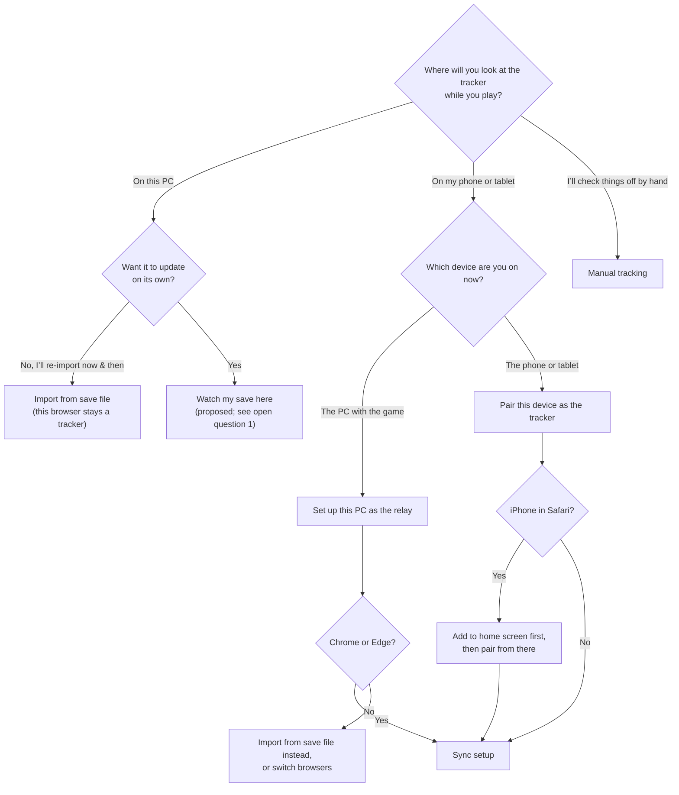

# Sync setup & pairing

tl;dr: Every browser gets an explicit role. A **tracker** is where you check things off; a **relay**
is the PC browser that watches the game’s save and sends it to one paired tracker. A first-look
chooser asks where you’ll look at the tracker while you play, and that one answer picks import,
sync, or manual tracking. This document is the journey & decision flow for #131; the protocol is in
[sync.md](sync.md). UI & copy wait until the flow is settled.

Status: flow in review on #131. The
[design canvas](https://claude.ai/artifact/UhDfkQVf4Csu7eN9RcBStx) is paused at an earlier flow; its
visual direction (lowercase roman numerals for steps, photo-mount corners on the drop box & code)
carries forward.

## Mental model

Three parts, named the same way everywhere:

1. **The game** writes a save file on the PC each time you sleep (and when you load in).
2. **The relay**, a browser tab on that PC, watches the file & sends each new save onward.
3. **The tracker**, on your phone, receives it & updates your progress.

Sync moves the game’s save, and only the save, in one direction. Anything checked off by hand stays
on the device where it was checked off.

## Roles

| Role              | Where                   | Checks things off          | Gets progress from                           |
| ----------------- | ----------------------- | -------------------------- | -------------------------------------------- |
| Tracker (default) | Any device              | Yes                        | Manual import, sync, or by hand              |
| Relay             | The PC running the game | No; the guide is read-only | Its own watched save, mirrored for reference |

- A browser is a tracker until it’s set up as a relay. Turning the relay off makes it a tracker
  again, with whatever progress it had before.
- **Why a relay doesn’t track.** If the PC tab took check-offs while relaying, they’d silently fail
  to reach the phone, which contradicts the mental model. A read-only mirror of the latest save
  keeps the guide useful on the PC without that trap. The relay already parses each save, so the
  mirror costs little.
- **The relay is a station, not a page.** In relay mode the app opens on a relay status view: which
  phone, which save, when it last sent. Browsing the guide is a side trip from there. Trouble takes
  over that view and stays until dismissed, so a broken relay is hard to miss.

## First look: the chooser

One question, on first run (onboarding) & at the top of Data, decides the path:

- “How it works” (the mental model) sits beside the chooser, collapsed but clearly labeled. Curious
  players open it; ready players skip it.
- The answer is remembered, and Data leads with the chosen path. The others stay one tap away.
- Manual import moves under a “Just this once” heading, so players can tell it won’t update on its
  own.

## Sync setup journey

Setup starts on whichever device the player is holding, and both paths converge on the same order:
pair first, then connect the save. `mistria.fyi/sync` is the address either device names for the
other.

Why pair first: the player sees success on the phone immediately, and the moment they finish
connecting the save, progress lands on the phone, which demonstrates the whole system once.

## Living with it

| Stage           | Relay (PC)                                                          | Tracker (phone)                                                            |
| --------------- | ------------------------------------------------------------------- | -------------------------------------------------------------------------- |
| Playing         | Station view open; nothing to do                                    | “Updated from your PC {time ago}” stamp                                    |
| Away for days   | Pairing lapses after 14 days unseen; station says to re-pair        | Toast on open after an unusually long gap: is the relay still open?        |
| Browser restart | Asks to re-allow reading the save (one click; “every visit” sticks) | Nothing                                                                    |
| Game update     | Can’t read the save: takes over the station view                    | Keeps its last good progress; stamp ages                                   |
| App update      | Reloads itself at a safe moment                                     | Same; a version mismatch names the device that’s behind                    |
| New phone       | Pair again; the old phone stops receiving                           | Old phone keeps its progress; new one gets the next save                   |
| New farm        | Drop the new save                                                   | Asks “Is this the farm you’ve been tracking?”; backs up the old one (#135) |
| Kill switch     | “Sync is taking a break”                                            | Same; tracking by hand still works                                         |
| Stop syncing    | “Turn off sync”: back to a tracker                                  | Unpaired; keeps everything                                                 |

## Open questions

1. **Watch my save on the same PC.** The relay already watches & parses the save, so a single-device
   player could get automatic updates in the same browser, with no phone & no network. It answers
   “sync or import?” cleanly for PC-only players, but it’s new scope for the epic (#123) & blurs the
   tracker/relay split (this browser would be both, with no check-off trap since nothing leaves it).
   Recommendation: include it as a third role, “self-updating tracker”, after phone sync ships.
2. **Relay read-only mirror.** Recommendation above: yes. The alternative is hiding the guide in
   relay mode, which is simpler but makes the PC tab less useful.
3. **Can a relay serve more than one tracker?** sync.md fixes one phone per PC. The chooser assumes
   that; a tablet & phone together would need a protocol change.
4. **Steam Deck & Firefox.** Both paths depend on #130’s hardware checks; the chooser routes them to
   import until those land.

## Voice

When UI & copy resume, write like a chill, non-judgmental friend helping with a tech setup.

- **Casual & warm.** Contractions, plain words, a little encouragement. Never blame the player.
- **Linear.** Every screen answers “what do I do now?” with numbered steps in order. Cut anything
  that isn’t a step or the reason for one.
- **One mental model.** Name the game, the relay, & the tracker consistently (player-facing names to
  be chosen with the UI).
- **“Check off”, not “tick”,** matching the rest of the app.

## Decisions so far

- The PC confirms whoever scans the code, so a leaked code can’t silently redirect sync. See
  [the decision record](decisions/2026-10-27-sync-pairing-confirm.md).
- The pairing code starts covered; showing it is deliberate.
- Device names derive locally from the browser; renaming is out of scope for v1.
